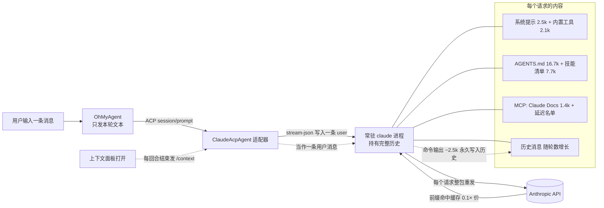

# Token 消耗:终端 Claude Code 对照实测与优化方案

> @author ixxxxoooo · 2026-10-23 · 问题:「同样聊天,OhMyAgent 的 token 比终端 Claude Code 涨得快,对不上」
> 前序:`20261020_Token消耗与上下文重复发送分析.md`、`20261021_上下文重复发送复核与业界对照.md`、开发进度 K72

## 结论(先看这里)

1. **同一段对话,应用发出的 token 比终端更少,不是更多。** 10 轮同题实测,应用配置的输入侧计费当量是终端 TUI 的 **85%**:终端交互模式把内置工具全量放进每个请求(15.1k),SDK 模式(应用走的路)内置工具按需加载(只放 2.1k)。
2. **「对不上」主要是统计口径不同**:终端转圈处的 `↓ N tokens` 只是**输出**;应用回合结束行是「输入(新输入 + 缓存写 + 缓存读)+ 输出 = 共 N」。同一个问题,终端显示约 300,应用显示约 8.5 万。上下文环形图也一样:应用默认窗口 200k,终端 Opus 是 1M,同样 3.1 万上下文,应用显示 16%,终端 3%。
3. **真实多耗的地方(已定位,属本项目问题)**:打开「上下文用量」面板时,应用每回合结束向会话发一次 `/context` 来刷新明细。Claude Code 会把本地命令的输出写进对话历史,**每次约 2.5k token 永久留在上下文里**,之后每个请求都要再读一遍。10 轮多耗 **34.5%**,轮数越多越严重,还会提早触发压缩。Claude Code 有不进对话的控制请求 `get_context_usage` 可替代(已验证)。
4. **前缀里最大的一块是项目记忆 `AGENTS.md`(16.7k,占每请求约 36%)**,其次是 55 个技能清单(7.7k)。这两块终端和应用一样都要付,精简后两边都受益。

## 实验方法

- 同一组 10 个问题(纯问答 6 个 + 读文件/搜索 4 个),同一目录(本仓库)、同一账号(claude.ai 登录,Opus 5.5),`claude` 2.1.309。
- 不接代理(代理会改变 Claude Code 的按需加载默认值),统一从 `~/.claude/projects/<会话>.jsonl` 读**每个 API 请求**的 usage(按 `message.id` 去重)。
- 应用配置按稳定版正在运行的会话进程(`ps`)抓到的真实参数和环境变量复刻:`--tools=default --mcp-config <Bridge> --setting-sources user,project,local --include-partial-messages --replay-user-messages --settings {"autoCompactWindow":200000}`、`ENABLE_TOOL_SEARCH=true`、`CLAUDE_CODE_MAX_CONTEXT_TOKENS=200000`,`initialize` 带 5 个钩子与图表追加提示。Bridge 用等价假服务(从真实 Bridge `tools/list` 取同样的 23 个工具定义,调用返回 ok),避免影响正在使用的会话。

| 组 | 配置 |
|---|---|
| A 终端 TUI | pty 里启动真实交互式 `claude`,逐条键入 |
| C SDK 裸跑 | `claude -p` stream-json,默认参数(区分「交互 vs SDK」本身的差异) |
| B 应用配置 | 上述复刻参数 |
| D 应用 + 面板打开 | B + 每轮结束发 `/context`(复刻 `ContextUsagePanel` 的刷新) |

## 结果

| 组 | 请求数 | 首请求前缀 | 第 10 轮上下文 | 缓存写 | 缓存读 | 输出 | 计费当量* | 相对 A |
|---|---|---|---|---|---|---|---|---|
| A 终端 TUI | 14 | 57,882 | 62,429 | 34,548 | 816,232 | 1,482 | 132,246 | 100% |
| C SDK 裸跑 | 14 | 41,912 | 46,583 | 36,090 | 592,433 | 1,405 | 111,409 | 84% |
| **B 应用配置** | 14 | 42,410 | 47,077 | 36,600 | 598,619 | 1,402 | **112,650** | **85%** |
| D 应用 + 面板 | 14 | 42,410 | **68,780** | **58,278** | 714,578 | 1,445 | **151,558** | **115%** |

\* 按 Anthropic 价格倍率折算成「全价输入 token」:新输入 1×、缓存写 1.25×、缓存读 0.1×、输出 5×。新输入每组都只有 28(每请求 2~4),缓存完全命中。

- B 比 C 只多约 500 token 前缀(图表提示 + Bridge 延迟工具名单),外加每会话一次约 1.2k 的 Haiku 标题请求,可忽略。
- D 从第 2 轮起每轮多写约 2.5k 缓存:`/context` 输出被追加进历史,上下文从 47k 涨到 69k。

## 发送前的上下文组成与必要性(问题 1)

应用会话第一个请求约 4.24 万 token,`get_context_usage` 分类如下(未单列的约 1.1 万为延迟工具名单、环境与 git 状态、系统提醒,三组都有):

| 组成 | token | 来源 | 是否必须 |
|---|---|---|---|
| Claude Code 系统提示 | 2.5k | Claude Code | 必须 |
| 应用追加提示(图表 `ChartPrompt`) | ~0.1k | OhMyAgent | 需要(Bridge 的 `chart_guide` 配套) |
| 内置工具(已加载) | 2.1k | Claude Code | 必须 |
| 内置工具(延迟,15.9k) | 只发名单 | Claude Code | 已是最优 |
| Bridge 23 个工具(延迟,5.1k) | 只发名单 | OhMyAgent | 已按需加载,开销很小;`browser_*` 12 个只在有浏览器标签时才有用 |
| claude.ai 连接器 Claude Docs(8 个工具 + 说明) | 1.4k | claude.ai 账号 | **非必须**(写代码时用不到);`ENABLE_CLAUDEAI_MCP_SERVERS=false` 可去掉,已验证 |
| 用户记忆 `~/.claude/CLAUDE.md` + `RTK.md` | 0.7k | 用户 | 需要 |
| 项目记忆 `AGENTS.md` | **16.7k** | 本仓库 | 规则必须,但模块地图/脚本清单等可按需读,**可精简** |
| 技能清单 55 个 | 7.7k | 用户 25 个 + claude.ai 同步 13 个 + 内置 17 个 | **部分非必须**:iOS/watchOS/visionOS/App Store/法务/变现/增长等与 macOS 工程无关;docx/pptx/xlsx/Google Workspace/morning 等同步技能约 2.9k |
| 钩子(PostToolUse 等 5 个) | 0 | OhMyAgent | 只回 `continue: true`,不注入内容 |
| OpenCode(注册表里的 ACP Agent) | 0 | OhMyAgent | 不注入 Claude 会话 |
| 自定义子代理 | 0 | — | 当前没有 |

## 原理图



```mermaid
sequenceDiagram
    participant UI as OhMyAgent 界面
    participant CC as claude 进程
    participant API as Anthropic API
    UI->>CC: 第 n 轮问题(只发增量)
    CC->>API: 前缀(已缓存)+ 历史 + 新问题
    API-->>CC: 回答;usage = 少量写入 + 大量缓存读
    CC-->>UI: result.usage
    Note over UI: 回合结束行「共 N token」把缓存读也算进去
    UI->>CC: /context(仅面板打开时)
    CC-->>UI: 明细文本
    Note over CC: 命令与输出进入历史,第 n+1 轮起每个请求多读 2.5k
```

## 优化方案(按收益排序)

| 优先级 | 改动 | 范围 | 预计收益 |
|---|---|---|---|
| P0 | 上下文明细改用控制请求 `get_context_usage`(返回结构化分类,不写转录、不进对话),不再发 `/context` | 代码:适配器加 ACP 扩展方法,`SessionModel.refreshContextUsage` 改调它 | 面板打开时省 25%+(10 轮),长会话更多;避免提前压缩 |
| P1 | 回合结束行与用量页按口径分开:「新增(输入 + 缓存写)」「输出」为主,缓存读灰显并标 0.1×,另给计费当量 | 代码:`TurnSummary`、`UsagePage` | 消除「对不上」的错觉 |
| P2 | 精简 `AGENTS.md`:保留规则,模块地图与脚本清单移到文档,用路径引用 | 文档 | 每请求约 -12k(约 -25%),终端与应用同时受益 |
| P2 | 清理无关技能(`~/.claude/skills` 下 iOS/visionOS/watchOS/App Store/法务/变现/增长等;claude.ai 同步技能按需关) | 用户配置 | 每请求约 -3k~-4.5k |
| P3 | 设置里提供「加载 claude.ai 连接器」开关(`ENABLE_CLAUDEAI_MCP_SERVERS`) | 代码:`SessionOptions.environment` | 每请求 -1.4k |
| 保持 | 200k 自动压缩窗口、`ENABLE_TOOL_SEARCH=true`、MCP 就绪后再发首条(K40b/8b44f40) | — | 已是最优,不要改回 |

使用习惯:无关话题新开会话;停顿超过缓存 TTL 再继续会有一次整段重写,属正常。

## 未验证 / 待确认

- 经模型映射网关(自定义 `ANTHROPIC_BASE_URL`)时按需加载是否生效:离线环境下 `/context` 只能本地估算(记忆文件 17.5k 变成 7.5k),数据不可信,需用真实映射会话复测。
- `skillOverrides` 设置项存在于 `claude` 二进制中,语义未验证,暂不作为方案。
- 套餐限额对缓存读/写的计法 Anthropic 未公开,计费当量只代表 API 价格。

## 复现

实验脚本在会话草稿目录(未入库:`drive_sdk.py` stream-json 驱动、`drive_tui.py` pty 驱动、`fake_bridge.py`、`analyze.py`、`ctl_probe.py`)。会消耗真实额度,单次 4 组约 50 万缓存读。
