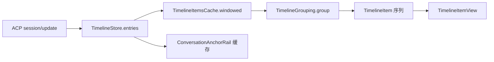

> @author ixxxxoooo
> 2026-10-24

# 重构规格 03：会话时间线与消息渲染

## 目录

1. [总览](#1-总览)
2. [会话流布局与容器](#2-会话流布局与容器)
3. [时间线条目模型与展示单元](#3-时间线条目模型与展示单元)
4. [条目种类逐项规格](#4-条目种类逐项规格)
5. [工具密度 ToolDensity 与分组](#5-工具密度-tooldensity-与分组)
6. [Markdown 与富文本渲染](#6-markdown-与富文本渲染)
7. [AppKit 文本叶子与 SelectionHub](#7-appkit-文本叶子与-selectionhub)
8. [吸顶用户消息与锚点导航](#8-吸顶用户消息与锚点导航)
9. [跟随底部、空白自愈与边缘渐隐](#9-跟随底部空白自愈与边缘渐隐)
10. [等待指示与回合结束行](#10-等待指示与回合结束行)
11. [输入区联动卡片（权限/提问/连接失败）](#11-输入区联动卡片权限提问连接失败)
12. [交互总表](#12-交互总表)
13. [状态与持久化](#13-状态与持久化)
14. [重构注意事项](#14-重构注意事项)
15. [源码索引](#15-源码索引)
16. [附录：补遗（第二轮）](#16-附录补遗第二轮)
17. [未覆盖/待确认项](#17-未覆盖待确认项)

---

## 1. 总览

### 1.1 职责边界

| 模块 | 职责 |
| --- | --- |
| `ChatKit/TimelineStore` | 把 ACP `session/update` 归并为 `TimelineEntry`；流式追加只刷新对应条目 |
| `ChatKit/ToolPresentation` + `TimelineGrouping` | 工具行摘要、浏览/活动分组、已结束回合 `TurnDigest` 折叠 |
| `ChatKit/TimelineWindow` + `TimelineItemsCache` | 长会话只渲染最近 N 轮；分组在窗口内条目上完成 |
| `OhMyAgentApp/ChatView` | 滚动、`FollowState`、吸顶、锚点栏、输入区栈、窗口化翻页 |
| 条目视图族 | `TimelineEntryViews`、`ToolRowViews`、`MarkdownView`、AppKit 叶子 |

### 1.2 技术栈要点

- 时间线主体：**SwiftUI** `ScrollView` + `LazyVStack` + `ScrollPosition(edge: .bottom)`。
- 可选中正文（助手 Markdown、代码块、命令输出、思考正文等）：**AppKit** `OMReadOnlyTextView` 族；跨块选择由 **`SelectionHub`** 统一接管。
- 令牌：颜色 `OMColors`、字号 `OMFonts`（含 `reading`/`readingMono` × `OMScale.timeline`）、圆角 `OMRadius`、间距 `OMSpacing`、动效 `OMMotion.standard`（150ms）。

### 1.3 数据流（简图）



---

## 2. 会话流布局与容器

### 2.1 线框图（非空会话）

```
┌─ ChatView ─────────────────────────────────────────────────────────────┐
│ OMColors.surface 全屏；点击空白可关闭上下文用量面板                      │
│ ┌ anchor rail ─┐ ┌──────────── ScrollView ────────────────────────────┐ │
│ │ 宽 30pt 区   │ │ LazyVStack spacing: 7(紧凑) / 14(默认)            │ │
│ │ 左 padding 6 │ │  maxWidth = ChatWidth.resolve(...)                 │ │
│ │ ≥2 条提问才显│ │  horizontal padding 20, top 12                     │ │
│ └──────────────┘ │  [显示更早 N 轮] → ForEach(TimelineItemView)       │ │
│                  │  → WorkingIndicatorView → bottom spacer 8pt        │ │
│                  └────────────────────────────────────────────────────┘ │
│  overlay: 顶 StickyUserOverlay | 底 JumpToLatest | 边缘 TimelineEdgeFade│
│ ┌ composerStack maxWidth=composerMaxWidth, horizontal 16, bottom 12 ─┐ │
│ │ 权限卡 / 提问卡 / 连接失败 / PlanDock / GoalChip / 用量面板 / 输入框 │ │
│ └────────────────────────────────────────────────────────────────────┘ │
└────────────────────────────────────────────────────────────────────────┘
```

**新会话**（`timeline.entries.isEmpty && !isReplaying`）：无时间线；`composerStack` 夹在上下 `Spacer` 之间，底部额外 `Color.clear` **72pt** 使视觉重心上移；`ProjectSwitcherButton` 显示；输入区 `composerMaxWidth = min(contentMaxWidth, ChatWidth.narrow.points)`。

### 2.2 聊天宽度 ChatWidth（8 档 + 自定义）

持久化：`ClientPrefs.Key.chatWidth` = `"chat.width"`；`ClientPrefs.Key.chatWidthCustom` = `"chat.widthCustom"`。

| 档位 rawValue | 显示名 | 最大宽度 (pt) |
| --- | --- | --- |
| compact | 紧凑 | 560 |
| narrow | 较窄 | 680 |
| standard | 标准 | 820（默认） |
| comfortable | 较宽 | 920 |
| wide | 宽 | 1000 |
| ultra | 超宽 | 1200 |
| full | 铺满 | ∞ |
| custom | 自定义 | `chat.widthCustom`，默认 **900** |

自定义：`ChatWidth.customRange` = **480…1600**，步长 **20**，`clampedCustom` 对齐步长；未知 rawValue 回退 **standard**。

设置路径：**设置 → 外观**（`GeneralAppearancePages`），滑块为 7 个预设（不含 custom），文案 `chatWidthSummary` = 档位名 + 解析后点数。

### 2.3 条目间距与紧凑密度

- `LazyVStack` 间距：`AppearanceModel.shared.isCompact ? **7** : **14**`（设置 → 外观「紧凑密度」）。
- 用户消息卡片：horizontal **14**，vertical **10**，trailing 额外 **44**（给悬停按钮留位）。
- 工具行/分组标题行：horizontal **8**，vertical **5**。
- 助手消息：horizontal **2** 外层 padding。

### 2.4 时间线窗口 TimelineWindow

| 常量 | 值 |
| --- | --- |
| `defaultTurns` | **40** 轮 |
| `pageTurns` | 每次「显示更早」再展开 **40** 轮 |

- **轮的定义**：非 `isSteered` 的 `.user` 条目开头；其前的条目（如开场提示）算第一轮的一部分。
- **顶部入口**：`EarlierTurnsRow`，文案 **「显示更早的 {N} 轮对话」**，图标 `chevron-up`，按钮 `.omSecondary`；`accessibilityLabel` = **「显示更早的对话」**。
- 点击后 `visibleTurns += pageTurns`，`scrollTo(id: anchor, anchor: .top)` 保持原顶部条目不动。
- **存档**：若 `archiveHiddenTurns > 0`，同一按钮从存档完整回显（`loadEarlierFromArchive`），运行中 `disabled(!model.canLoadEarlierArchive)`。
- 切换会话：`onChange(ObjectIdentifier(model))` 重置 `visibleTurns = defaultTurns`。

### 2.5 IDE Agent 面板

`ChatView(showsAnchorRail: false)` 可关闭左侧锚点条（IDE 窄面板）。

---

## 3. 时间线条目模型与展示单元

### 3.1 TimelineEntry.Kind

| kind | 用途 |
| --- | --- |
| user | 用户消息（可含图片、`isSteered` 引导） |
| assistant | 助手 Markdown 正文 |
| thought | 思考块 |
| tool | 工具调用 |
| plan | 旧式计划列表（TodoWrite 等写入） |
| notice | 提示/错误/中断/第三方 muted 通知 |
| changes | 本轮文件改动汇总 |
| planDoc | 计划模式 Markdown 计划文档 |
| turnSummary | 回合结束行（模型、耗时、token） |
| modelSwitch | 模型切换分割线 |

关键字段（节选）：`displayText`（用户带图时去掉 `[Image #N]` 占位）、`awaitingPermission`、`childStore`（子 Agent 内嵌时间线）、`elicitationOutcome`、`planPending`/`planBuilt`、`summary: TurnSummary?`、`replayDuration`。

### 3.2 TimelineItem（渲染层）

|  case | 含义 |
| --- | --- |
| `.entry(TimelineEntry)` | 单条目 |
| `.explore(ExploreGroup)` | 连续浏览/活动步骤分组 |
| `.digest(TurnDigest)` | 已结束回合的过程折叠行 |

`TimelineItemView` 使用 `Equatable`：**仅比较 `id` + `signature`**（结构不变则不重建行；流式内容由条目 `@Observable` 驱动）。

---

## 4. 条目种类逐项规格

以下格式：**触发** → **布局/文案/令牌** → **交互** → **状态变体** → **持久化/联动**。

### 4.1 用户消息 UserMessageView

**触发**：用户发送或引导（`isSteered`）写入 `kind == .user`。

**布局**：

```
┌─ omSolidChrome, cornerRadius OMRadius.modal ─────────────────────┐
│ [可选] Label「运行中引导」 corner-down-right, OMFonts.small       │
│ [可选] 横向 ScrollView 附件缩略图 72×72, spacing 6               │
│ CollapsibleUserText(displayText)                                  │
│                                          [悬停] copy | retry? | pen│
└───────────────────────────────────────────────────────────────────┘
```

- 悬停右下角：`OMCopyButton`「复制消息」→ 复制 **`entry.text`（原文，含 Image 占位）**；非 steered 时 `square-pen`「放大编辑」；若 `isLastUserMessage` 且非运行中：`rotate-cw`「重试」。
- 引导消息无编辑/重试，仅有复制。
- 无障碍：`accessibilityLabel` = **「你:{text}」**；非 steered 时 hint **「点击放大编辑」**。

**交互**：

- **单击卡片**（非 steered）：`sticky.beginEditing(entry, pinned: false)` 就地编辑（见 §8）。
- **右键** `omContextMenu`：**「复制」**（icon `copy`）、**「编辑并重新发送…」**（icon `pencil`，steered 无）。
- 附件缩略图点击 → `ImagePreviewStore.present`；tooltip **「点击查看原图」**。

**状态**：

- 被吸顶接管：`opacity 0` 保留布局并继续 `report` 几何。
- 正在就地编辑：原卡 `opacity 0`，overlay 顶对齐 `UserMessageEditor`。

**联动**：`StickyUserState`、文件 mention 打开（`CollapsibleUserText` / 叶子内 chip）。

---

### 4.2 助手消息 AssistantMessageView

**触发**：`kind == .assistant`，流式 `isStreaming`。

**布局**：`MarkdownView(text, streaming:)`，`frame maxWidth infinity`，padding horizontal **2**。

**交互**：段落/代码等经 AppKit 叶子选择；无条目级右键菜单。

---

### 4.3 思考块 ThoughtView

**触发**：`kind == .thought`。

**布局（默认折叠）**：

- 标题按钮：`chevron.right` 9pt，旋转 90° 当展开；文案流式时 **「思考中… {Int(elapsed)} 秒」**（`ActiveTimeline` 1s 刷新），结束 **「已思考 max(1, Int(round(elapsed))) 秒」**；`OMFonts.small`，`OMColors.secondaryText`。
- 展开：`ProseTextLeaf` 11.5pt，`secondaryText`，leading **15**。

**交互**：点击切换展开；`followSuspended = true`。默认**不**因流式自动展开。

---

### 4.4 工具行 ToolRowView（紧凑行 + 详情）

**触发**：`kind == .tool` 且非子 Agent 卡片形态。

**行结构（HStack spacing 7）**：

| 区域 | 规则 |
| --- | --- |
| Leading 图标 | 16×11.5 Lucide；Ask → `message-circle-question-mark`；失败 `OMColors.danger` 否则 `secondaryText` |
| MCP | `OMTag(server, accent)` |
| 子 Agent 类型 | `OMTag(agentType, accent)` |
| 动词 | `OMFonts.small` `secondaryText`，本地化见 ToolPresentation |
| 对象 | 路径→`OMFileIcon` + 文件名 `small.medium`；终端→`ShellCommandText`；搜索→`monoSmall` |
| detail | `caption` `tertiaryText`，单行 |
| 悬停 | 可打开文件 `arrow.up.right.square` 11；子 Agent `square-arrow-out-up-right`「在标签中打开…」 |
| Diff 统计 | `+N` `diffAdded` / `−N` `diffRemoved`，`monoSmall` |
| 耗时 | 终端态 `<1s` 不显示；格式同 ToolRowView.format |
| 状态 | pending→`OMStatusDot(.idle)`；inProgress→`OMSpinner(.mini)`；completed 无勾；failed→`xmark` 9 danger |
| 展开 | `chevron.right` 9，悬停或已展开可见，旋转 90° |

**ToolPresentation 文案模板（动词 / 对象，节选）**：

| 类别 | 动词（zh 键） | 对象/附注 |
| --- | --- | --- |
| read | 读取 | 路径；detail `L10-60` 等 |
| write | 写入 | 新建文件 |
| edit | 编辑 | |
| delete | 删除 | |
| move | 移动 | |
| search | 搜索 / 查找文件 | Glob/find_by_name |
| terminal | 运行 | 命令首行；detail=description 时行内显示说明、命令进详情 |
| fetch | 获取 / 联网搜索 | URL/query |
| mcp | MCP 工具名 (+N) | briefInput |
| subagent | 子任务 | description；detail「后台」 |
| plan | 提交计划 / 更新待办 | |
| think | 思考 | title |
| AskUserQuestion | 向你提问 | 「N 个问题」 |
| Await | 等待 | 「N 个后台任务」·「输出匹配 pattern」；detail 超时 |
| other | prettyTitle | |

**默认展开**（`expanded ?? defaultExpanded`）：

- `OMA_EXPAND_ALL=1`：全展开。
- 提问结果 `elicitationOutcome`：**展开**。
- 完成且 content 含 image：**展开**。
- **standard**：terminal **failed** → 展开。
- **detailed**：edit/write/terminal → 内联预览（高 **180pt** + **「显示全部」**）。
- 其余：**折叠**。

**详情块**（leading **23**，top 4 bottom 8）：MCP 入参 `KeyValueBox`、CommandBox、Diff、终端会话、SearchResults、子 `TimelineGrouping` 嵌套时间线（左竖线 2pt）、`QuestionAnswerView` 等。

**Canvas**：`CanvasToolRef.of(tool)` 时在行下 `CanvasCardView`，leading 23，vertical 6。

**交互**：

- 点击：可展开则 toggle（`followSuspended = true`）；不可展开则打开文件。
- **右键**（子 Agent 行内工具行）：**「在标签中打开子 Agent 会话」**、**「查看子 Agent 定义…」**（打开设置 subagents 页）。

**子 Agent 卡片**：`presentation.category == .subagent` 时用 `SubagentCardView` 替代表格行（见 §4.14）。

---

### 4.5 浏览/活动分组 ExploreGroupView

**触发**：`TimelineGrouping.groupFlat` 合并 ≥2 个 explore 工具（或 compact 下单个 terminal/search/read/fetch 也折叠）。

**标题行**：

- 图标：activity → `layers`；explore → `text.magnifyingglass`；11.5pt，宽 16。
- 摘要 `group.summary`（见 §5）；运行中 `flowingText(true)` 流光。
- 默认**折叠**；`OMA_EXPAND_ALL` 默认展开。

**运行中 + 折叠 + (`group.isRunning` 或 `liveTail`)**：下方 `GroupLatestStepView`（§5.3）。

**展开**：子条目 `TimelineEntryView`，leading **28**，左竖线 hairline 1pt @15.5。

---

### 4.6 回合折叠 TurnDigestView

**触发**：回合已有 `turnSummary`（或回放 `replayDuration`），过程条目被折入 `TurnDigest`。

**折叠行**：**「已工作 {durationText}」** + chevron；`durationText` 规则：&lt;60s →「N秒」；&lt;3600 →「M分S秒」；否则「H小时M分」。

**展开**：对 `digest.entries` 再 `TimelineGrouping.group`（当前 ToolDensity），leading 12，左竖线 1pt。

---

### 4.7 权限请求（输入区 PermissionCard）

**位置**：`composerStack` 顶部 `ForEach(pendingPermissions)`。

**非计划批准**：

- 标题行：工具类图标 + **「需要你的许可」**（计划批准分支见 PlanApprovalCard）。
- `prompt.title`：`monoSmall` 最多 4 行。
- 可选命令块 `ShellCommandText` in subtleFill。
- 预览：Diff / Markdown，`AutoHeightScroll` max **260**（计划文本 max **320**）。
- 按钮：`prompt.request.options`，`allowOnce` → primary（或计划 warm），其余 secondary。

**计划批准**：`PlanApprovalCard`（§4.12）。

---

### 4.8 提问向导（输入区 + 时间线结果）

**输入区**：`ElicitationCard` → AskUserQuestion 为 `QuestionWizardCard`（§11）。

**时间线**：工具行展开为 `QuestionAnswerView`（`QuestionWizardView.swift`）展示问答结果；`elicitationOutcome` 或 replay 还原。

---

### 4.9 计划条目

| 视图 | 场景 |
| --- | --- |
| `PlanView` | `kind == .plan`，卡片内 Todo 列表 |
| `PlanDocView` | `kind == .planDoc`，计划卡（待批准/已 Build） |
| `PlanDock` | 输入区上方，最后一条 plan 的 **「待办 done/total」** 折叠条 |
| `PlanApprovalCard` | 输入区计划批准条 |

`PlanDocView`：`planPending` → 标签 **「待批准」** warning；`planBuilt` → **「已 Build」** success；默认 `planPending` 时 **expanded = true**。

---

### 4.10 提示 NoticeView

| 条件 | 表现 |
| --- | --- |
| `severity == "interrupt"` | 发丝线 + **「circle-stop」** + 文案，caption tertiary |
| `isMuted` | 无图标，`OutputTextLeaf` tertiary，max 40 行 |
| 标准 | Label + icon（error/warning/info）；可选 `detail` Markdown |

`isError` 与 severity 共同决定 tint（danger/warning/secondaryText）。

---

### 4.11 模型切换 ModelSwitchDividerView

居中 **「由 {from} 切换为 {to}」**，`arrow-left-right` 12，`caption` tertiary；两侧 0.5pt hairline。

---

### 4.12 回合结束 TurnSummaryView

**触发**：`kind == .turnSummary`，`entry.summary: TurnSummary`。

**布局（HStack spacing 8，padding h4 v2）**：

1. 若 `outputText` 非空：`OMCopyButton` **「复制回复」** → 复制助手正文非元数据。
2. `git-branch` 12 → Fork Chat（`workbench.forkConversation`）。
3. 可选 `BrandIconView` 12。
4. `summary.parts.joined(separator: "  ·  ")` caption tertiary 单行 tail；`omTooltip(tokenDetail)` 多行明细。

**TurnSummary.parts 顺序**（有则追加）：模型名 → durationText → token 摘要（有缓存时分「新增/缓存读/输出」）→ 缓存命中 % → tps → **「完成于 {time}」**。

---

### 4.13 本轮改动 ChangesSummaryView

**触发**：`kind == .changes`；**运行中隐藏**（`EmptyView`）。

**卡片**：

- 标题 **「{n} File Changed / Files Changed」**（英文原文 UI）。
- **「全部撤销」**、**「Review」**（IDE `openChanges` 或 workbench diff）。
- 每文件 `FileChangeRow`：点击开 diff/IDE；悬停打开编辑器、撤销等。

---

### 4.14 子 Agent 卡 SubagentCardView

两行无框按钮；图标 `SubagentIcon` 14；阶段：启动中/运行中/后台运行/已完成/已失败；待办 **「待办 done/total」**；点击 `openSubagent` 标签页。

**右键**：同工具行子 Agent 菜单。

---

### 4.15 图片

- 用户附件：`AttachmentThumbnail` 72（时间线）/ 56（输入区）；上限 **5MB**/`ImageAttachment.maxBytes`。
- 工具 content image：`ToolImageView`。
- 灯箱：`ImagePreviewView` / `ImagePreviewStore`。

---

### 4.16 画布 / 浏览器

- MCP canvas 工具：`CanvasCardView` 附在工具行下（前缀 `canvas_` 不并入 explore 分组）。
- 浏览器日志等待确认：待确认（本规格未读 BrowserBridge 卡片视图，见 §16）。

---

### 4.17 Diff 卡

- 工具详情：`SnippetDiffView` / `SideBySideDiffView`（DiffKit）；统计色 `diffAdded`/`diffRemoved`。
- 权限预览：同上嵌在 PermissionCard。

---

### 4.18 连接失败 ConnectionFailureCard

输入区：`exclamationmark.triangle.fill` warning + message（small，5 行）+ **「重试」**；`omGlassCard`。

---

## 5. 工具密度 ToolDensity 与分组

持久化：`chat.toolDensity`（`ToolDensity.preferenceKey`），默认 **standard**。

| 档位 | 显示名 | 分组行为 |
| --- | --- | --- |
| compact | 精简 | 连续非 subagent/plan/think/awaitingPermission 工具合并为 **activity** 组；单条 grep/cat 等也可 solo 折叠 |
| standard | 标准 | 仅 **explore**（read/search/fetch + 非授权 MCP，非 canvas）合并 |
| detailed | 详细 | 同 standard 分组；edit/write/terminal 默认内联预览 180pt |

**回合结束后**：无论哪档，过程均先折为 **TurnDigest**「已工作 …」；展开后再按档位分组。

**ExploreGroup 摘要**：

- explore：**「正在浏览/已浏览」** + 「N 个文件、M 次搜索…」
- activity：按类计数 **「编辑了/运行了/读取了…」** 等（ShellIntent 区分 grep vs cat）

### 5.3 GroupLatestStepView

- 行高 **22pt**；leading **28**；工具间空窗 **0.3s** 后 **「规划下一步…」**（`sparkles`）；尾部流式思考 **「思考中…」**（`brain`）。
- 运行中工具文案 `.flowingText(!terminal)`；transition 新行从 bottom 入、旧行 top 出（0.2s easeOut；减少动态则 opacity）。

---

## 6. Markdown 与富文本渲染

### 6.1 块级解析 ChatKit.MarkdownParser

支持：heading、paragraph、code fence、list（含 task `- [ ]`）、quote、table、rule、**HTML 注释块**（`<!--` … `-->` 整段丢弃）。

流式：`parseState(_:continuing:)` 回退重解析最后 **2** 块。

### 6.2 段间距

- 会话默认：块间距 **10**；`markdownDocument` 环境为 **16**。
- 标题字号（基准 × `OMScale.ui * OMScale.timeline`）：H1 **20**，H2 **17**，H3 **15**，H4+ **14**；字重 medium；H1/H2 段前留白 6/2（文档 28/20）。

正文 **13×scale**；引用左缩进 **13**，竖条由 layoutManager 绘制；列表每级缩进 **16**。

### 6.3 行内

- `AttributedString(markdown:)` + `InlineMarkdownCache`；链接色 `OMColors.link`。
- 行内代码：`OMFonts.readingMono`，`accentText`，底 `accent.opacity(0.1)`，圆角 `OMRadius.tag`，左右 U+200A  padding。

### 6.4 代码块 CodeBlockView

- `omSolidCard`；头：语言或 **「代码」**，`caption`；复制 22×22，`copy`/`check`，tooltip **「复制代码」**。
- 正文 `CodeTextLeaf`；换行：`ClientPrefs.Key.chatCodeWrap` = **`chat.codeWrap`**。

### 6.5 表格 TableBlockView

- `TableTextLeaf`（NSTextTable）；悬停且 `overflows` 时 **「放大查看」** `maximize-2` → `TableExpander.present`。
- 宽度量化 8pt 网格。

### 6.6 Mermaid / Chart

- 围栏 **闭合后**：language `mermaid` → `MermaidBlockView` 或 xychart 转 `ChartFenceView`；`chart` JSON → `ChartFenceView`。
- 点击图表悬浮：`MermaidFloatingView`；导出 `MermaidExport.swift`。

### 6.7 文件 chip / mention

- `MarkdownTextRun` / `FileChipViews`：行内文件引用；点击打开（⌥ 反向目标）；复制还原为记号（`copyTextKey`）。

### 6.8 HTML 注释

解析阶段跳过，**不渲染**（与 GitHub/VS Code 一致）。

---

## 7. AppKit 文本叶子与 SelectionHub

### 7.1 设计

- 每叶子 = 一个 **Atom**（键 = 内容坐标左上角）；拖动选择由 **`SelectionHub.shared.track`** 独占 mouse loop。
- 选区高亮：`OMColors.accent.opacity(0.28)`；滚出视口时 **冻结** `frozenStorage` 仍可复制。

### 7.2 快捷键与菜单

| 操作 | 行为 |
| --- | --- |
| ⌘C | 有 hub 选区 → `copySelection()` 模型文本；否则叶子内 `copyText(in:)` |
| ⌘A | 会话 ScrollView 内 → hub `selectAll` 已挂载叶子 |
| 右键 | 有 hub 选区时仅 **「复制所选」**（禁用系统多项菜单） |

拖选到边缘自动滚动 → `onAutoScroll` → **`followSuspended = true`**。

### 7.3 单击语义

- 用户正文叶子：无选区单击 → `onPlainClick` 进入编辑。
- 文件 chip / `oma-file:` 链接：单击打开（拖动阈值 4pt 内）。

---

## 8. 吸顶用户消息与锚点导航

### 8.1 StickyUser 逻辑

- `pushZone = cardHeight + 24`；`StickyUser.resolve` 决定 `stickyID` / `nextID`；`pushOffset` 顶出上一卡。
- 编辑：`beginEditing` / `finishEditing`；吸顶发起 `editorPinned = true` → `StickyUserOverlay` 顶浮层。
- `followSuspended`：展开工具/编辑/锚点跳转时暂停贴底，回到底部后恢复。

### 8.2 ConversationAnchorRail

- **显示条件**：≥ **2** 条非 steered 用户消息。
- 刻度 Dock 放大（宽×高×opacity）：距离 0 → **26×2×1**；1 → 18×1.5×0.6；2 → 13×1.5×0.45；默认 8×1.5；当前项 18×2×0.9。
- 行高 **17pt**；抽样 `AnchorRailMetrics.sample`；预览卡宽 **280**，padding 12，`omGlassCard`。
- 预览文案：**「第 N / total 次提问」** + title + body（最多 2/3 行）。
- 点击：`AnchorJumpAction` → 必要时扩大 `visibleTurns` 再 `scrollTo(id, anchor: .top)`；`followSuspended = true`。

---

## 9. 跟随底部、空白自愈与边缘渐隐

### 9.1 FollowState

| 常量/字段 | 值 |
| --- | --- |
| `bottomTolerance` | **48pt** |
| `showsJumpButton` | `!pinned` |
| `unseen` | 放手后新增条目数 |
| `hasActivity` | 放手后有流式/进度更新 |

**规则**：距底 ≤48 → 贴底清零；用户向上滚或 `userScrolling` 且离开底部 → 放手；贴底且非用户滚动 → `contentChanged` 返回应 scrollTo bottom。

### 9.2 JumpToLatestButton

- 文案：`unseen>0` → **「{n} 条新消息」**；否则 `hasActivity` → **「有新内容」**；否则 **「回到最新」**。
- 样式：`arrow-down` 11 + small，`omGlassCard`，bottom padding **10**。

### 9.3 TimelineBlankGuard

- 条件：`hasEntries && containerHeight>0 && visibleCount<=0`。
- 防抖 400ms（标签激活 600ms）；限流 1s；贴底时 scroll 先 -1 再 bottom，非贴底 ±1 轻推。

### 9.4 TimelineEdgeFade

- 顶 **18pt**、底 **32pt** 渐变至 surface；`offsetY>2` / 离底 >4pt 时启用。

---

## 10. 等待指示与回合结束行

### 10.1 WorkingIndicatorView

- 条件：`model.isRunning && turnStartedAt`。
- 左：`OMGlyphCycle`（风格见 `WorkingVerbStyle`）；等待用户/权限时 **静止** tertiary。
- 文案：
  - 有待处理权限/提问：**「等待你的回复… ({elapsed})」**
  - 等子代理：**「等待子代理」** / **「等待 N 个子代理」** + WorkingStatus.line
  - 否则：`WorkingStatus.verb(seed: turnStart 秒)` + **「… ({elapsed} · 按 Esc 中断)」**

### 10.2 WorkingVerbStyle

持久化：`appearance.workingVerbStyle`；默认 **classic**。

| rawValue | 标题 | 动词示例 |
| --- | --- | --- |
| classic | 经典 | 思考中、琢磨中… |
| playful | 趣味 | 摸鱼中、炼丹中… |
| claudeCode | Claude Code | 沉思中、踱步中… |
| poetic | 诗意 | 凝神中、遐思中… |
| geek | 极客 | 编译宇宙中… |
| minimal | 极简 | 工作中 |

glyphFrames：classic/playful/claudeCode 为 ·✢✳✶✻✽…；geek 为 Braille 动画；minimal ●◉○◉。

---

## 11. 输入区联动卡片（权限/提问/连接失败）

### 11.1 QuestionWizardCard（摘要）

- 头：**「提问」**；折叠 chevron；queued 时 Tag **「还有 N 个待回答」**。
- 脚：**「跳过 ⎋」** secondary；**「下一题/提交 ⏎」** primary；多题 pager **‹ i/n ›**。
- 键盘：A–Z 选项、Enter 前进、Esc 跳过（详见 `QuestionWizardView.swift`）。

---

## 12. 交互总表

| 区域 | 单击 | 双击 | 右键/菜单 | 键盘 |
| --- | --- | --- | --- | --- |
| 用户消息卡 | 编辑 | — | 复制、编辑并重新发送 | — |
| 用户正文叶子 | 编辑（无选区） | 选词 | hub：复制所选 | ⌘C/A |
| 助手 Markdown | 选择 | 选词 | hub | ⌘C/A |
| 工具行 | 展开/打开文件 | — | 子 Agent 两项 | — |
| 分组/_digest | 展开折叠 | — | — | — |
| 锚点刻度 | 跳转提问 | — | — | — |
| 回到最新按钮 | 贴底 | — | — | — |
| 提问向导 | 选项 | — | — | A–Z, ⏎, ⎋ |

---

## 13. 状态与持久化

| 键 | 含义 | 默认 |
| --- | --- | --- |
| `chat.width` | ChatWidth rawValue | standard |
| `chat.widthCustom` | 自定义宽度 | 900 |
| `chat.toolDensity` | compact/standard/detailed | standard |
| `chat.codeWrap` | 代码块换行 | false |
| `appearance.workingVerbStyle` | WorkingVerbStyle | classic |
| `appearance` 紧凑密度 | `AppearanceModel.isCompact` | 待读 GeneralAppearancePages 默认 |
| `terminal.fontSize` | 工具输出等 | 见 ClientPrefs |

内存态（不持久化）：`visibleTurns`、`FollowTracker`、`StickyUserState`、`TimelineItemsCache` 窗口键、`expanded` 工具/分组本地 `@State`。

---

## 14. 重构注意事项

1. **性能**：`TimelineItemView.equatable` + 条目 `@Observable`；`structureRevision` 与纯文本 revision 分离；分组只在窗口内 O(window) 而非全量 O(n)。
2. **勿用 `.id` 强制主题刷新**：读 `OMColors` 即可；AppKit 叶子监听 `ThemeRuntime.didChange`。
3. **展开动画**：工具/分组展开**不做**整体高度动画（LazyVStack 卡顿）；仅 chevron 0.15s snappy。
4. **贴底 vs 展开**：任何增高内容应设 `followSuspended`，几何回调里仅当 `old.contentHeight == new.contentHeight` 且距底 ≤4 才恢复。
5. **SelectionHub** 与 NSTextView 原生选区互斥；hub 存续时右键菜单只有一项。
6. **TurnDigest 与 ToolDensity**：折叠行文案与展开后分组档位独立；改分组逻辑须测回放 `replayDuration` 提前折叠。
7. **ChangesSummaryView** 英文标题 **File Changed** 为界面原文（待产品是否中文化）。
8. **纸感**：用户气泡 `omSolidChrome` 非玻璃；输入区卡片可用 `omGlassCard`（玻璃主题）。

---

## 15. 源码索引

| 功能 | 路径 |
| --- | --- |
| 对话容器 | `Sources/OhMyAgentApp/ChatView.swift` |
| 条目分发 | `Sources/OhMyAgentApp/TimelineEntryViews.swift` |
| 工具行/分组/_digest | `Sources/OhMyAgentApp/ToolRowViews.swift` |
| 权限/提问卡 | `Sources/OhMyAgentApp/ToolViews.swift` |
| 计划 UI | `Sources/OhMyAgentApp/PlanViews.swift`, `PlanApprovalCard.swift` |
| 子 Agent 卡 | `Sources/OhMyAgentApp/SubagentCardView.swift` |
| 提问向导/答案 | `Sources/OhMyAgentApp/QuestionWizardView.swift` |
| Markdown | `Sources/OhMyAgentApp/MarkdownView.swift`, `MarkdownTextRun.swift`, `InlineMarkdownCache.swift` |
| 命令/ANSI 输出 | `Sources/OhMyAgentApp/CommandOutputViews.swift`, `ANSITextView.swift` |
| Diff | `Sources/OhMyAgentApp/DiffViews.swift`, `SideBySideDiffView.swift` |
| 改动汇总 | `Sources/OhMyAgentApp/ChangesViews.swift` |
| 文本叶子/中枢 | `Sources/OhMyAgentApp/OMReadOnlyTextView.swift`, `OMTextLeaf*.swift`, `SelectionHub.swift` |
| 吸顶/编辑 | `Sources/OhMyAgentApp/StickyUserViews.swift`, `ChatKit/StickyUser.swift` |
| 锚点 | `Sources/OhMyAgentApp/ConversationAnchorRail.swift`, `ConversationAnchorLogic.swift` |
| 跟随/空白 | `Sources/OhMyAgentApp/FollowTracker.swift`, `ChatKit/FollowState.swift`, `TimelineBlankGuard.swift` |
| 等待行 | `Sources/OhMyAgentApp/WorkingIndicatorView.swift`, `ChatKit/WorkingStatus.swift`, `WorkingVerbStyle.swift` |
| 模型/分组 | `Sources/ChatKit/TimelineStore.swift`, `TimelineWindow.swift`, `ToolPresentation.swift` |
| 回合摘要 | `Sources/ChatKit/TurnSummary.swift` |
| 分组 ticker | `Sources/ChatKit/ExploreGroupTicker.swift` |
| 聊天宽度 | `Sources/ChatKit/SessionOptions.swift` (`ChatWidth`) |
| 偏好键 | `Sources/ChatKit/ClientPrefs.swift` |
| Mermaid/图表 | `Sources/OhMyAgentApp/MermaidBlockView.swift`, `MermaidFloatingView.swift`, `ChartFenceView.swift` |
| 表格放大 | `Sources/OhMyAgentApp/TableExpandView.swift` |
| 图片 | `Sources/OhMyAgentApp/ToolImageView.swift`, `ImagePreviewView.swift`, `MentionChipImage.swift` |
| 子 Agent 标签内容 | `Sources/OhMyAgentApp/Dock/SubagentTabView.swift` |
| 性能叶子 | `Sources/OhMyAgentApp/TimelineChatLeaves.swift` |

---

## 附录 A：终端输出 TerminalOutputView

**场景**：工具 `content` 含 `.terminal(id)` 且 `model.terminals[id]` 存在。

**布局**（padding 10，subtleFill + `OMRadius.control`）：

- 头行 `monoSmall`：`$` + `ShellCommandText`（最多 6 行）+ Tag **「沙箱」** / **「后台」** + 运行中 `OMSpinner` + **「停止」**（`.omSecondary.mini`）+ 退出 Tag / signal + **「在终端面板查看」** `square-terminal` + `CopyButton`（ANSI 剥 plain）。
- 若 `awaitsBufferedOutput`：**「命令运行中,结束后才会返回输出」** caption。
- 输出区 `ScrollView` + `ANSITextView`，`maxHeight` **240**（`fillHeight` 时无限）；流式滚到底。
- 沙箱拦截：**「命令可能被沙箱拦截…」** + **「放行一次并重试」**。
- 截断提示：**「输出过长,仅显示末尾部分」**。

字号：`ClientPrefs.Key.terminalFontSize`（默认 **12.0**）。

---

## 附录 B：CollapsibleOutput / CommandBox

- `CommandBox`：命令超 **6** 行可 **「展开完整命令/收起命令」** `chevrons-up-down`；输出用 `CollapsibleOutput`，运行中 `followTail`。
- `TextOutputBox`：8pt padding，subtleFill；默认 ANSI 开。
- `ToolErrorBox`：最多 **40** 行 tail，`circle-alert`，danger tint。

---

## 附录 C：PlanDocView 页脚按钮（完整）

| 按钮 | 样式 | 行为 |
| --- | --- | --- |
| 收起计划 / 查看完整计划 | omPlain | toggle `expanded` |
| 在新会话中 Build | omPlain | `PlanActions.buildInNewSession` |
| 在标签页打开 | omPlain | `openPlan(planFileURL)` |
| 保存到工作区 / 已保存到工作区 | omPlain | `savePlanToWorkspace`；已保存 disabled |
| 复制计划 | OMCopyButton 12 | `plan.body` |

成功 note：caption success；路径 caption tertiary 单行 middle。

---

## 附录 D：QuestionAnswerView（时间线内）

- 卡片 `omSolidCard` padding 12。
- 标题 Label：`outcome.title`；icon answered `circle-check` / 否则 `circle-x`；small medium secondary。
- 每题：可选 `OMTag(header)` + 题干 body medium；多选 Tag **「可多选」**。
- 答案行：`check` 12 accent + 答案文本；底 selectedFill + accent 描边 0.5。
- 无答案：answered → **「未回答」**；否则 **「—」**。

---

## 附录 E：右键菜单全表（时间线相关）

| 挂载视图 | 菜单项 | 图标 | 条件 |
| --- | --- | --- | --- |
| UserMessageView | 复制 | copy | 始终 |
| UserMessageView | 编辑并重新发送… | pencil | 非 isSteered |
| ToolRowView | 在标签中打开子 Agent 会话 | external-link | category subagent 且 childStore |
| ToolRowView | 查看子 Agent 定义… | bot | category subagent |
| SubagentCardView | 同上两项 | 同上 | 同左 |
| OMReadOnlyTextView（hub 有选区） | 复制所选 | — | AppKit NSMenu，无 Lucide |
| 其余助手/工具/分组 | — | — | 无 omContextMenu |

---

## 附录 F：TimelineGrouping 折叠规则（TurnDigest）

**不折叠**（回合结束后仍可见）：用户、notice、changes、planDoc、turnSummary、modelSwitch、最终 assistant 文本、canvas MCP 工具行、带 `elicitationOutcome` 的问答、画布卡片。

**折叠进 digest**：thought、plan、非最终 assistant、普通 tool（除上述例外）。

---

## 附录 G：组件树（ChatView 时间线分支）

```
ChatView
└─ timeline: ScrollView
   └─ LazyVStack
      ├─ EarlierTurnsRow?
      ├─ ForEach → TimelineItemView.equatable
      │   ├─ TimelineEntryView
      │   │   ├─ UserMessageView
      │   │   ├─ AssistantMessageView → MarkdownView
      │   │   ├─ ThoughtView
      │   │   ├─ ToolRowView → ToolDetailsView / SubagentCardView
      │   │   ├─ PlanView / PlanDocView / NoticeView / ChangesSummaryView
      │   │   ├─ TurnSummaryView / ModelSwitchDividerView
      │   ├─ ExploreGroupView → GroupLatestStepView?
      │   └─ TurnDigestView
      ├─ WorkingIndicatorView
      └─ Color.clear#bottom
```

---

## 16. 附录：补遗（第二轮）

### 16.1 画布卡片 CanvasCardView

**挂载位置**：`ToolRowView` 内，仅当 `CanvasToolRef.of(tool) != nil` 且工具 **已完成**（`status == .completed`）；在紧凑行下方，leading **23pt**，vertical **6pt**。

**数据**（`ChatKit/CanvasBridge.swift`）：从 MCP `canvas_create` / `canvas_update` 的结果文本解析 `canvas_id:`；`title` 来自入参 `title`；`isUpdate` 区分 create/update。

**布局**（maxWidth **420pt**）：

```
┌─ Button plain ─────────────────────────────────────────────┐
│ [chart-column 16] 32×32 底 selectedFill + OMRadius.control │
│  标题: summary?.title ?? ref.title ?? canvasID  body.medium│
│  副标题: isUpdate ?「已更新画布 · 点击打开」:「画布 · 点击打开」 caption │
│  Spacer  square-arrow-out-up-right 12 tertiary             │
└─ padding 10, card/hover subtleFill, hairline 0.5 ──────────┘
```

**交互**：点击 → `workbench.openCanvas(id:title:)`，标题 fallback **「画布」**。悬停切换 card/subtleFill。`task(id: canvasID)` 异步读 `CanvasStore.app.list()` 刷新标题。

**状态**：无独立 loading/error 视图；未完成工具 **不显示** 卡片。

### 16.2 内置浏览器 browser_*（时间线）

**无单独「浏览器卡片」视图**：Bridge 工具 `browser_navigate`、`browser_snapshot`、`browser_click` 等走 `ToolPresentation` 的 **`kind == .other`** 分支（工具名不在 read/edit/… 特例里时）。

| 紧凑行字段 | 规则 |
| --- | --- |
| category | `.other` |
| verb | **空**（不显示动词列） |
| subject | `prettyTitle(tool.title)`：去 `Running ` 前缀、`_`→空格；若 title 空则 `tool.name` 或 **「工具调用」** |
| 图标 | `wrench.and.screwdriver`（11.5pt） |
| 默认展开 | 同通用工具；`browser_screenshot` 完成且 content 含 **image** 时 **默认展开**（与工具行策略一致） |
| 详情 | 文本/快照在 `TextOutputBox`；截图在 `ToolImageView` |

**点击**：有详情则展开；无详情且无可打开路径时无跳转（浏览器页在 workbench 标签，非时间线卡片）。

### 16.3 用户消息编辑流程

#### 16.3.1 入口

| 入口 | 行为 |
| --- | --- |
| 单击用户卡（非 steered） | `beginEditing(entry, pinned: false)` 原位编辑 |
| 单击正文叶子（无选区） | 同上 `onClick` |
| 悬停 `square-pen` / 吸顶卡 | `pinned: true` → `StickyUserOverlay` 顶浮；`false` → 行内 overlay |
| 右键 **「编辑并重新发送…」** | `pinned: false` |
| 吸顶卡单击 | `pinned: true` |

**编辑中**：原卡 `opacity 0` 占位 + 顶对齐 overlay（`maxHeight: 0` 容器 trick）；`zIndex 10`；`EditingElevation` 压过工具分组。

#### 16.3.2 UserMessageEditor 布局

- 与输入区同构：`VStack spacing 8`；padding h**14** v**10**；`OMRadius.modal` + `omGlass`（纸感垫 `OMColors.surface`）。
- 附件：横向 ScrollView，缩略图 **56pt**（只读，不可删）。
- `ComposerTextView`：初始 `entry.displayText`；高度 **34pt** 起，max **320pt**；placeholder 空。
- 运行中提示：**「回合进行中,将排到本轮结束后发送。」** caption tertiary。
- 底栏：左 **模型** 按钮（`OptionMenu` 300pt 宽，有 model 选项时）；右 **「取消」** plain + `.keyboardShortcut(.cancelAction)`（Esc）；发送：
  - 纸感/Ink：**「重新发送 (⌘Return)」** `ComposerPaperSendButton` + ⌘Return；
  - 玻璃：**圆形** `arrow.up` 26×26 `.glassProminent` + ⌘Return，`disabled(!canResend)`。

#### 16.3.3 保存语义（源码为准）

- **编辑发送 `resend()`**：注释 **「作为新消息重新发送(原消息与回复保留)」** → `model.send(prompt, images:, afterTurn: model.isRunning)` → **不截断时间线、不回退检查点**；运行中则 **排队到本轮结束**（或 steer，取决于 `ClientPrefs.runningSendMode`，与 `afterTurn` 组合见 `SessionModel.send`）。
- **重试 `retryUserMessage`**（仅最后一条用户消息、非运行中）：**截断**该条及之后条目 → 再 `send` 同文同图 → **覆盖式重发**。
- **取消**：`onClose()` / Esc / 点击外部 `omDismissOnClickOutside` → `finishEditing()`，**不写回**时间线。

**草稿**：`StickyUserState.editDraft` 用于吸顶/原位切换不丢字（编辑器 init 仍从 `displayText` 起）。

#### 16.3.4 CollapsibleUserText

| 常量 | 值 |
| --- | --- |
| `collapsedLines` | **6** |
| `expandedMaxLines` | **24** |
| `charsPerLine`（估算） | **48** |
| 行高 | `13 × OMScale.ui × OMScale.timeline × readingLineHeightRatio` |

- 短消息：`ProseTextLeaf` 13pt timeline。
- 长消息：固定窗口高 `windowHeight`；收起时 `omBottomFade`（maskInk 0→0.78→clear）；**悬停**才 `scrollDisabled(false)` 内滚。
- 按钮：**「展开」** / **「收起」** + chevron 10；tooltip **「展开全部内容」** / **「收起长消息」**。

#### 16.3.5 吸顶 StickyUserCard

- 附件最多 **4** 个缩略图 **30pt**，超出 **「+N」**。
- 正文 **lineLimit(3)**，`OMFonts.reading`；含 `@` 时用 `MentionChipImage.inlineText`。
- 底 `surface` + `omGlass`；padding 同用户卡。

### 16.4 QuestionWizardCard（AskUserQuestion）

**容器**：`omGlassCard`；头高 **32**；体 padding **12**；脚 padding h12 v8。

**头**：折叠 chevron；**「提问」** small medium；多题 **「N 题」** caption；queued Tag **「还有 N 个待回答」**。

**QuestionBody**：Tag header + 题干 body medium；多选 Tag **「可多选」**；选项区高 `min(max(各题估算高), **260**)` 内滚；>6 选项 **2 列** Grid spacing 6。

**选项行**：字母徽标 A–Z（18×18，选中 `actionFill`）；标题 body + 可选 description caption；选中右侧 `check` 12。**「其他…」** TextField plain，`onSubmit`→advance；键盘选第 N+1 字母聚焦 other。

**脚**：pager **‹ i/n ›**；末题未答 **「还有 N 题未回答」**；**「跳过 ⎋」** secondary small；**「下一题/提交 ⏎」** primary small，`disabled(!canAdvance)`（末题需 **全部** `isAnswered`）。

**键盘**（焦点在 card）：Return→advance；Esc→skip；←/→ 翻题；a–z 选选项（单选后 **180ms** 自动下一题，末题不自动提交）。other 焦点时 Esc 回 card。

**提交**：`prompt.accept()` + `onFinish()`；跳过 `prompt.decline()`。

**时间线摘要卡**：见附录 D `QuestionAnswerView`。

### 16.5 GenericElicitationCard

**标题**：**「Agent 想向你确认」** + `questionmark.bubble`；message body 可选。

| `ElicitFieldKind` | UI | 必填 `isSatisfied` |
| --- | --- | --- |
| `.text` | 多行 TextField roundedBorder 1…4 行 | trim 非空 |
| `.number(isInteger)` | TextField 占位 **「数字」** | `Double(text) != nil` |
| `.boolean` | Toggle **「是」** switch | **始终 true**（必填也满足） |
| `.single(options)` | 圆形图标单选列表 | `selection` 非空 |
| `.multi(options)` | 方形图标多选 | `selection` 非空 |

**整表提交**：`canSubmit = fields.allSatisfy(\.isSatisfied)`；**无单独字段级错误文案**（仅禁用 **「提交」**）。

**URL 模式**：展示 URL monoSmall；**「跳过」** + **「打开链接」** primary（打开后 `acceptURL`）。

### 16.6 AppearanceModel.isCompact 与 flowingText

| 项 | 值 |
| --- | --- |
| 存储键 | `UserDefaults` **`appearance.compact`** |
| 默认值 | **`false`** |
| 设置入口 | **设置 → 外观 →「紧凑密度」** `SettingsToggleRow` 绑定 `$appearance.isCompact` |
| 时间线影响 | `LazyVStack` spacing **7**（否则 **14**）；`WorkbenchKit/CompactLayout` 等全局紧凑布局亦读此标志 |

**flowingText**（`FlowEffects.swift` + `LoopLayers.swift`）：

- active 且未 reduceMotion：正文先 **`secondaryText`**，再 `.omFlowOverlay(primaryText)`。
- **经典** `FlowStyle.classic`（默认，`appearance.flowStyle`）：单色带，带宽 `max(width×**0.45**, **28**)`，扫动 **2.4s** 循环。
- **流光溢彩** `FlowStyle.aurora`：palette `[accent, accent2, success, warning, accent]`，带宽 `max(width×**0.9**, **56**)`，扫动 **3.2s**。
- 动画由 `OMLoopGated` + Core Animation；标签不可见/应用不可见/减少动态时停。

**使用处**：`ExploreGroupView.summary` 运行中、`GroupLatestStepView` 运行工具文案等。

### 16.7 CollapsibleOutput（命令/工具文本输出）

| 常量 | 值 |
| --- | --- |
| `foldThreshold` | **12** 行（总有效行数） |
| `collapsedHeight` | **196pt** |
| `expandedHeight` | **480pt** |
| `renderLimit` | 末尾 **2000** 行 |
| 省略提示 | **「已省略前 N 行,仅显示末尾 2000 行(复制可得完整输出)」** |
| 展开按钮 | **「展开 · 共 {totalLines} 行」** / **「收起」** + `chevrons-up-down` 10，caption |
| a11y | **「展开全部输出」** / **「收起输出」** |

（与 ToolRow **详细档内联预览 180pt** 是不同机制。）

### 16.8 SubagentTabView vs 主会话

| 维度 | 主 ChatView | SubagentTabView |
| --- | --- | --- |
| 只读 | 否 | 头栏 Tag **「只读」**；无输入框 |
| 窗口化 | **40 轮**（用户消息） | **120 条 TimelineItem**；按钮 **「显示更早的 N 条」** plain |
| 滚动锚点 | 贴底 + FollowState | `.defaultScrollAnchor(.top)` |
| Follow/吸顶/锚点条 | 有 | **无** |
| 内容 | 全会话 | 顶 **SubagentPromptCard**（`CollapsibleUserText`）+ `childStore` 分组时间线 |
| 底栏 | WorkingIndicator | **SubagentStatusFooter**（运行无 Esc 提示；结束统计+复制） |
| 空态 | 新会话 UI | **「子 Agent 还没有产生内容」** |
| 失效 | — | **「这个子任务已不可用」** EmptyState |

### 16.9 SubagentCardView 状态视觉

| phase | 行1 | 行2 左 | 行2 右（非 active） |
| --- | --- | --- | --- |
| starting | 标题 + 类型 | Spinner + **「启动中」** secondary | — |
| running | 同上 | Spinner + **「运行中」** accentText | `activityText` caption 1 行 |
| backgroundRunning | 同上 | 空心环 + **「后台运行」** accentText | activityText |
| completed | 同上 | check + **「已完成」** success | `SubagentSummary.parts`（用时、N 次工具调用、tokens） |
| failed | 同上 | circle-x + **「已失败」** danger | 同上 summary |

图标色：failed→danger；active→accent；否则 secondary。待办：**「待办 done/total」** caption（`todoTotal>0`）。

### 16.10 ChatStatusViews.swift

文件**仅含** `GoalChip`（`/goal` 目标条，在 **composerStack** 非时间线）。**无**独立「聊天状态条」组件；文件名历史遗留，**不可删**（`ChatView` 引用 `GoalChip`）。

### 16.11 紧凑工具行：按工具名（ToolPresentation）

**三态说明**：**动词+对象+附注** 文案在 pending/inProgress/completed **不变**；差异仅 **行内状态**（idle 点 / mini Spinner / 无勾 / xmark danger）、**前景色**（failed→danger）、**耗时**（进行中 1s 刷新）、**无障碍** `statusText`：**「等待中」/「进行中」/「已完成」/「失败」**。

| 工具/条件 | category | 图标 Lucide | 紧凑行模板（verb · subject · detail） |
| --- | --- | --- | --- |
| **Read** 等 `kind==read` | read | doc.text | **读取** · {path\|title} · {Lx-y…} |
| **Grep** 等 search 且 name≠Glob/find_by_name | search | magnifyingglass | **搜索** · {pattern\|title} · {path 末段\|glob} |
| **Glob** / find_by_name | search | magnifyingglass | **查找文件** · {pattern\|title} · … |
| **Edit**（非新建） | edit | pencil | **编辑** · {path} · 行范围 |
| **Write** / createToolNames / diff 无 old | write | doc.badge.plus | **写入** · {path} · 行范围 |
| **Delete** | delete | trash | **删除** · {path} |
| **Move** | move | arrow.right.doc.on.clipboard | **移动** · {path} |
| **Bash** 等 `kind==execute` | terminal | terminal | **运行** · {命令首行} · {description?}；有 description 时行内只显示说明 |
| **WebFetch** 等 fetch 且非 WebSearch | fetch | globe | **获取** · {url\|query\|title} |
| **WebSearch** / search_web | fetch | globe | **联网搜索** · {url\|query\|title} |
| **Task** / **Agent**（或 hasChild） | subagent | bot（**整卡** SubagentCardView） | **子任务** · {description\|title} · {**后台**?} + Tag agentType |
| **TodoWrite** | plan | checklist | **更新待办** · （subject 空） |
| **ExitPlanMode** | plan | checklist | **提交计划** · （subject 空） |
| **AskUserQuestion** | other | message-circle-question-mark | **向你提问** · **「N 个问题」** 或空 |
| **Await** | other | wrench.and.screwdriver | **等待** · {后台任务/输出匹配…\|title} · {超时 xs?} |
| **Think** | think | brain | **思考** · {title} |
| switchMode | other | wrench… | **切换模式** · {title} |
| **MCP**（含 canvas_* 未完成） | mcp | brand.mcp | **{toolName}(+N)** · briefInput · Tag **server** |
| **canvas_create/update** 完成后 | mcp 行 + **CanvasCardView** | 同行 + 卡片 | 同上 MCP 行；卡片见 §16.1 |
| **browser_***（Bridge，`kind` 通常 other） | other | wrench.and.screwdriver | （verb 空）**{prettyTitle(title)}** |
| 其它 `kind==other` | other | wrench.and.screwdriver | （verb 空）**{prettyTitle(title)\|name\|「工具调用」}** |

**可点击目标**：路径类 read/write/edit → 悬停 **打开文件** / 无详情时点击打开；subagent → 开标签；canvas 卡片 → openCanvas；browser 无统一「打开浏览器标签」在时间线行上（待 Agent 集成方式）。

---

## 17. 未覆盖/待确认项

1. **browser_* 工具**是否在部分适配器下映射为 `kind==execute/fetch` 而非 other（需按真实 ACP 载荷抽样）。
2. **`UserMessageEditor` 的 `editDraft`** 与 `StickyUserState` 切换时序（何时写入 draft）未逐行追踪。
3. **Playwright MCP**（`mcp__playwright__browser_*`）与内置 Bridge `browser_*` 在 UI 上共用 MCP 行模板，权限/详情差异未展开。
4. **`CollapsibleOutput`** 在 `followTail` 下的 scroll 行为与极大输出内存策略仅读常量，未压测。
5. **Elicitation 数字字段**非法输入时无 inline 错误，仅提交禁用——是否为产品预期待确认。

---

*文档版本：2026-10-24，含第二轮补遗；重构请以源码为准核对。*
