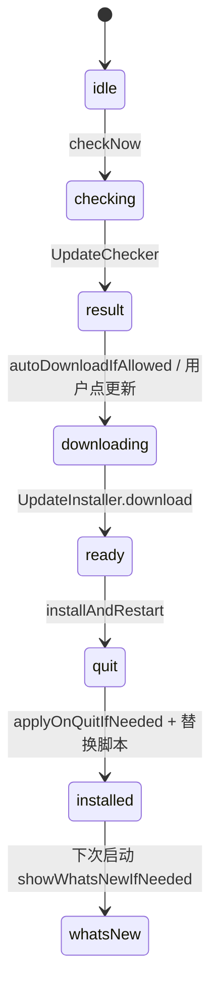

> @author ixxxxoooo
> 2026-10-24

# 重构规格 07c：自动化、更新机制与配置文件落盘

> 文档 07 第三部分：`Automation/*`、`AutomationKit`、更新（`UpdateModel` / `UpdateFooterButton` / `UpdateWhatsNew`）、以及用户可见的配置文件读-改-写规则。设置页骨架见 `07a`，各设置项见 `07b`。

## 目录

1. [自动化页总览](#1-自动化页总览)
2. [AutomationPage 布局与交互](#2-automationpage-布局与交互)
3. [AutomationEditor 表单](#3-automationeditor-表单)
4. [调度、并发、超时与补跑](#4-调度并发超时与补跑)
5. [模板与运行器](#5-模板与运行器)
6. [更新机制](#6-更新机制)
7. [配置文件落盘清单](#7-配置文件落盘清单)
8. [重构注意事项](#8-重构注意事项)
9. [源码索引](#9-源码索引)
10. [未覆盖 / 待确认项](#10-未覆盖--待确认项)

---

## 1. 自动化页总览

| 项 | 值 |
| --- | --- |
| 入口 | 工作台编辑区标签「自动化」（与 Customize 并列，非设置侧栏） |
| 视图 | `AutomationPage(workbench:)` |
| 服务 | `AutomationService.shared` → `AutomationCenter` |
| 持久化 | `AppEnv.supportDirectory/automations.json`（演示模式见 Demo 沙盒路径） |
| 演示模式 | `AutomationService.start()` 只 load，**不** `center.start()` 自动调度 |

---

## 2. AutomationPage 布局与交互

### 2.1 ASCII 线框

```
┌─ AutomationPage ─────────────────────────────────────────────┐
│ ┌─ list 240pt ─┬─ detail (ScrollView, content max 760) ────┐ │
│ │ 标题「自动化」│  详情头: 名 + 启用开关 + 立即运行/停止 + 编辑 + 删 │ │
│ │ + 新建 omIcon│  infoGrid: 项目/计划/下次运行/权限              │ │
│ │              │  提示词只读卡片                                   │ │
│ │ 列表行 44pt  │  运行记录列表                                     │ │
│ │ OMStatusDot  │                                                   │ │
│ └──────────────┴──────────────────────────────────────────────────┘ │
└──────────────────────────────────────────────────────────────────┘
```

- 左列宽 **240pt**；列表行高 **44pt**；选中背景 `OMColors.pressedFill`。
- 右列编辑时：`AutomationEditor` 替换详情（maxWidth 640 表单区）。

### 2.2 左列

- 标题 `OMFonts.title`「自动化」。
- 新建：`plus` omIcon → `omPicker` 宽 **280**，placement belowTrailing。
- 候选：`blank`「空白自动化」；模板组 `AutomationTemplate.all`，id 前缀 `tpl:`，icon `sparkles`。
- 空列表：图标 `workflow` 22pt +「还没有自动化」。

### 2.3 列表行状态点 (`OMStatusDot`)

| 条件 | 状态 |
| --- | --- |
| `center.runningIDs` 含 id | running |
| !enabled | idle |
| 最近 run failed/timedOut | failure |
| 否则 | success |

### 2.4 详情头操作

| 控件 | 行为 |
| --- | --- |
| OMSwitch「启用自动化」 | `center.setEnabled` |
| 运行中 | Button「停止」`square` → `center.cancel` |
| 空闲 | Button「立即运行」`circle-play` omPrimary → `center.runNow` |
| 编辑 | `pencil` → `AutomationDraft(automation)` |
| 删除 | `trash` → confirmationDialog「删除这个自动化?」消息「同时会删除它的运行记录,已生成的会话不受影响。」 |

### 2.5 欢迎页（无选中）

- 标题「让 Agent 按计划自己干活」
- 说明段（原文 360pt 宽居中）
- 四个模板按钮（同 AutomationTemplate.all）
- 「新建空白自动化」omSecondary

### 2.6 运行记录行

- 状态点 + status.title + 开始时间 + 耗时 + Tag「手动」（trigger manual）
- 复制摘要 `OMCopyButton`；有 sessionID 时「打开会话」→ `workbench.openHistory`

---

## 3. AutomationEditor 表单

| 字段 | 控件 | 校验/说明 |
| --- | --- | --- |
| 名称 | TextField prompt「例如:每日变更摘要」 | — |
| 项目 | omPicker 320 宽，entries 来自 `workbench.orderedProjects` | 路径存 `draft.projectPath` |
| 计划 | 见 §3.1 | `draft.schedule` |
| 权限 | `OMCompactSegmented` `AutomationPermissionMode` | Note：无人值守自动拒绝需授权操作 |
| 提示词 | TextEditor minHeight **140**，`settingsEditorStyle` | — |
| 保存/取消 | omPrimary / omSecondary | `onSave` 返回错误字符串 |

标题：「新建自动化」/「编辑自动化」`OMFonts.title`。

### 3.1 计划类型 (`AutomationScheduleKind`)

| kind | UI | 参数 |
| --- | --- | --- |
| interval | 「每隔」+ 数字 + 「分钟(最少 5)」 | `intervalMinutes` ≥ **5** |
| daily | DatePicker 时分 | hour, minute |
| weekly | 星期 pill（周一在前：2…7,1）+ timeRow | weekdays Set, hour, minute |
| cron | TextField mono prompt「分 时 日 月 周,如 0 9 * * 1-5」 | 5 段 cron 子集 |

- 合法时显示「下一次:…」formatted abbreviated + short time。
- `validationMessage()` 失败则不显示下次时间。

### 3.2 Cron 子集语法（`AutomationSchedule` / `CronSpec`）

- **5 段**：分(0–59) 时(0–23) 日(1–31) 月(1–12) 周(0–7，7→周日)。
- 支持：`*`、`*/n`、`a`、`a-b`、`a-b/n`、逗号列表。
- 日+周均非 `*` 时为 **或** 关系（标准 cron）。
- 搜索下一触发最多 **366** 天；找不到返回 nil。

### 3.3 权限模式

读 `AutomationPermissionMode.allCases` 的 `title` 与 `acpValue`（重构时读 `AutomationKit/Automation.swift`）。

---

## 4. 调度、并发、超时与补跑

| 参数 | 默认 | 说明 |
| --- | --- | --- |
| 调度节拍 | **30s** | `AutomationCenter.start(interval:)` |
| maxConcurrent | **2**（范围 1…8） | tick 时不超过上限 |
| runTimeout | **1800s**（30min） | 单次运行超时 → timedOut |
| 启动时 | `tick()` 立即一次 | 注释：**错过的任务补跑一次**（isDue 逻辑） |
| runNow | **忽略**调度与并发上限 | 已在运行则忽略 |
| 损坏文件 | 移到 `.corrupt` 备份 | 库重建 |
| 异常退出 | running 记录 → failed | 摘要「应用退出时运行被中断」 |
| 写盘 | 300ms debounce + atomic | prettyPrinted sortedKeys ISO8601 日期 |

**演示模式**：不启动 ticker；运行完成不系统通知。

---

## 5. 模板与运行器

### 5.1 AutomationTemplate.all（内置 4 个）

| id | 名称 | 计划 | permission |
| --- | --- | --- | --- |
| daily-digest | 每日变更摘要 | cron `0 9 * * 1-5` | readOnly |
| weekly-deps | 每周依赖检查 | weekly 周一 10:00 | readOnly |
| todo-sweep | 待办扫描 | daily 18:00 | readOnly |
| branch-hygiene | 分支整理提醒 | weekly 周五 17:30 | readOnly |

各模板 `prompt` 全文见 `AutomationTemplates.swift`（均含「不要修改任何文件」类约束）。

### 5.2 AutomationRunner（无 UI）

1. 校验项目目录存在。
2. `AppEnvironment.makeSession` + 默认 Agent；`attention` 独立、`notifier = nil`。
3. connect 超时 **90s**；phase failed 即失败。
4. 设置 permission mode（ACP option 匹配时）。
5. `send(prompt)`；等待轮次开始最多 **30s**；运行结束取 assistant 摘要 ≤600 字。
6. `rejectUnattendedPrompts`：权限 reject；elicitation cancel。

连接/启动超时、取消行为见 `AutomationService.swift`。

---

## 6. 更新机制

### 6.1 UserDefaults 键

| 键 | 含义 | 默认 |
| --- | --- | --- |
| `update.auto` | 启动自动检查 | true |
| `update.mode` | `UpdateMode`: remind / download / auto | download |
| `update.channel` | 渠道 | stable |
| `update.feedURL` | 自定义 feed（可空） | — |
| `update.lastCheck` | 上次检查时间 | — |
| `update.whatsNew` | 待展示说明 JSON（WhatsNew） | — |

### 6.2 AboutPage 交互

- Toggle「自动检查更新」
- Picker「更新方式」：仅提醒 / 自动下载 / 自动下载并在最佳时间安装
- 「立即检查」→ `UpdateModel.checkNow()`；旁显示 state（已最新 / 下载进度 / 更新按钮等）
- Note：非计费网络才自动下载；最佳安装=空闲 15min 且无 running/needsInput 会话，或退出时

### 6.3 UpdateFooterButton（侧栏底 / IDE 状态栏 compact 16pt 高）

- 无更新：**不占位**（`spec` 返回 nil）
- 有 available：`更新` pill accent；tooltip 发现版本
- downloading：百分比 + spinner
- ready：「更新」→ `installAndRestart()`

### 6.4 UpdateModel 关键流程



- **开发版** / 演示：`canSelfInstall == false` → 对话框「开发版不支持自动更新」/`Scripts/promote.sh`
- **菜单**「检查更新…」：`checkInteractively()` → OMDialog 已最新 / 发现新版本(稍后|前往下载) / 失败
- **WhatsNew**：安装前 `remember(version,notes)`；启动 `takePending` 若 currentVersion ≥ 记录版本 → `OMDialog.alert`「已更新到 x」+ bullet 列表（`;` 或换行分隔，最多 12 条展示）
- 发现新版本通知：`AppNotifier`「OhMyAgent 有新版本」
- 下载完通知（mode ≠ auto）：「新版本已下载」点侧栏更新

### 6.5 UpdateChecker 数据源

- GitHub 最新正式版（repositoryURL / releasesURL 在 About 链出）
- 开发版只下载不替换自身（About Note 原文）

---

## 7. 配置文件落盘清单

### 7.1 路径总表

| 文件/目录 | 位置 | 读写方 | 用户可见行为 |
| --- | --- | --- | --- |
| settings.json | `~/.claude/` 用户；`<ws>/.claude/` 项目；`settings.local.json` 本地 | ClaudeSettingsModel / SettingsStore | 设置页 Agent/权限/隐私 env 等；**保留未知键**；写前备份 `.oma-backup` |
| .mcp.json | 项目根 | MCPStore | MCP 页项目级服务器；需批准才启动 |
| ~/.claude.json | 用户主目录 | MCPStore / ProjectTrust | MCP 用户级；**项目信任**状态 |
| providers.json | `AppEnv.supportDirectory` | ProviderSettingsModel | 模型提供商+映射；**不改** settings.json |
| 密钥文件 | `ProviderStorage`（UI 显示 paths） | 0600 | 不进日志与 ~/.claude |
| agents.json | `AppEnv.supportDirectory` | AgentRegistryModel | Agent 注册表页；写前 `.oma-backup`（AgentRegistry） |
| automations.json | `AppEnv.supportDirectory` | AutomationCenter | 自动化库 |
| themes/*.json | `AppEnv.supportDirectory/themes/` | ThemeRuntime | 自定义主题 version:1 |
| usage-index.json | App Support | UsageStats 缓存 | 用量页加速 |
| .oma-backup | 各配置同目录 | JSONFile.write | 高级页计数与清理 |
| CLAUDE.md / rules / skills 等 | .claude 下按 scope | ConfigCenter | Customize/扩展页 |

### 7.2 JSONFile 读-改-写规则

1. `read()`：无文件 → `{}`；非法 JSON → `ConfigError.invalidJSON`。
2. `write()`：创建目录；若已有文件 → 复制到 `<name>.oma-backup`（先删旧 backup）；`JSONSerialization` prettyPrinted + **sortedKeys**；**atomic** 写。
3. `update(body)`：read → mutate → write（未知字段随整对象保留，除非 body 删除）。

### 7.3 SettingsStore 合并规则

- **生效值**：local > project > user（标量覆盖，**不**合并数组）。
- 写路径：`set(path, value, scope)`；nil 删键。

### 7.4 providers.json / 映射

- 切换 `useMapping`、槽位 `ModelTarget`、上下文窗口等读-改-写 providers.json（见 `ModelProvider.swift`）。
- 变更后刷新空闲会话（SessionModel 内逻辑）。

### 7.5 MCP 优先级（ClaudeConfigKit）

- 注释：local > project > user；项目 `.mcp.json` 待批准条目在 MCP 行展示警告。

### 7.6 ClientPrefs.resetAll 前缀

`general.`, `update.`, `editor.`, `terminal.`, `usage.`, `privacy.`, `advanced.`, `feature.`, `appearance.`, `shortcut.`, `chat.`, `notify.`, `network.`, `prompt.` — **不含** `scm.`, `session.`, `codeIntel.`, `worktree.` 等（高级页「恢复默认」仅清上述）。

---

## 8. 重构注意事项

1. **自动化与设置分离**：调度在 AutomationKit，UI 不在 SettingsRouter。
2. **runNow 不受并发限制** vs tick 受 maxConcurrent——测试时勿混淆。
3. **更新安装**依赖退出钩子 `applyOnQuitIfNeeded`；用户取消退出会 `terminationCancelled` 撤销重启。
4. **WhatsNew** 键不在 reset 列表，更新失败会保留到下次成功。
5. **演示模式** automations 路径与禁用调度，CI/截图需设 `OMA_DEMO`。
6. 配置写回必须走 `JSONFile`/`SettingsStore`，避免丢未知字段导致 Claude Code 兼容问题。

---

## 9. 源码索引

| 功能 | 路径 |
| --- | --- |
| 自动化 UI | `OhMyAgentApp/Automation/AutomationPage.swift`, `AutomationEditor.swift`, `AutomationService.swift` |
| 自动化核心 | `AutomationKit/AutomationCenter.swift`, `AutomationSchedule.swift`, `AutomationTemplates.swift`, `Automation.swift`, `AutomationDraft.swift` |
| 更新 UI | `OhMyAgentApp/UpdateModel.swift`, `UpdateFooterButton.swift`, `AboutPage.swift` |
| 更新逻辑 | `ChatKit/UpdateChecker.swift`, `UpdateInstaller.swift`, `UpdateWhatsNew.swift` |
| 配置路径 | `ClaudeConfigKit/ConfigCore.swift`, `SettingsStore.swift`, `MCPStore.swift` |
| 提供商/Agent 落盘 | `ChatKit/ModelProvider.swift`, `AgentHost/AgentRegistry.swift` |

---

## 10. 未覆盖 / 待确认项

1. 自动化 `validationMessage()` 全文与 cron 示例 → [07f §6](./20261024_重构规格_07f_外观隐私诊断逐项补遗.md#6-自动化-validationmessage-全文与-cron-示例)。
2. `UpdateChecker` / 安装校验 / 更新 UI 文案 → [07f §7](./20261024_重构规格_07f_外观隐私诊断逐项补遗.md#7-更新updatechecker--安装校验--ui-文案)。
3. `ProviderStorage` 密钥文件名规则 → 07d + `ModelProvider.swift`。
