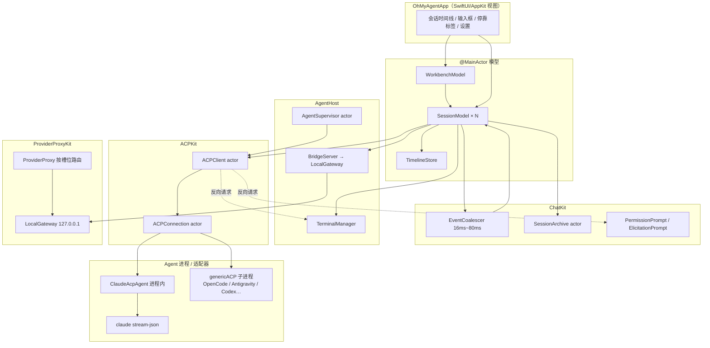

> @author ixxxxoooo  
> 2026-10-24

# 重构规格 09：引擎层与数据层契约

> **读者**：重写 UI 的开发者（无源码访问权）。  
> **目标**：在不动 ACP / 适配器 / 网关 / Bridge / 持久化格式的前提下，明确 UI 应订阅哪些模型、调用哪些动作、如何处理事件与边界。

---

## 目录

1. [总览与架构](#1-总览与架构)
2. [并发与线程模型](#2-并发与线程模型)
3. [SessionModel（UI 契约）](#3-sessionmodelui-契约)
4. [TimelineStore 与条目模型](#4-timelinestore-与条目模型)
5. [WorkbenchModel（UI 契约）](#5-workbenchmodelui-契约)
6. [ACP 协议：方法、通知与能力](#6-acp-协议方法通知与能力)
7. [Bridge MCP 工具](#7-bridge-mcp-工具)
8. [ProviderProxyKit 与本机网关](#8-providerproxykit-与本机网关)
9. [持久化数据格式](#9-持久化数据格式)
10. [引擎差异与能力矩阵](#10-引擎差异与能力矩阵)
11. [错误、恢复与用户指引](#11-错误恢复与用户指引)
12. [交互总表与终端/回合模型](#12-交互总表与终端回合模型)
13. [周边 Kit 对外接口摘要](#13-周边-kit-对外接口摘要)
14. [重构注意事项](#14-重构注意事项)
15. [源码索引](#15-源码索引)
16. [附录：补遗](#16-附录补遗)
17. [未覆盖 / 待确认项](#17-未覆盖--待确认项)

---

## 1. 总览与架构

OhMyAgent 的 Agent 工作台通过 **ACP v1（stdio JSON-RPC）** 驱动本机已安装的 Claude Code 或其它 ACP Agent。UI 层**不**直接读写 JSON-RPC；它只绑定 `@MainActor` 的 `SessionModel` / `WorkbenchModel`，由 ChatKit / WorkbenchKit 在后台完成协议与落盘。



**数据流（一轮对话）**：

1. UI 调用 `SessionModel.send` / `sendDraft` → 主线程写入 `TimelineStore.appendUser`（或 steer / 排队）。
2. `SessionModel` 经 `ACPClient.prompt` 发 `session/prompt`；`ACPConnection` 在 **actor** 上收发 JSON-RPC。
3. 适配器/Agent 通过 **`session/update` 通知** 流式推送；`ACPClient` 解析为 `ClientEvent.sessionUpdate` → `EventCoalescer` 合并 → 主线程 `TimelineStore.apply`。
4. Agent 反向调用 `session/request_permission`、`terminal/*`、`fs/*`、`elicitation/*` → `SessionDelegate` → `SessionModel` 挂起 `PermissionPrompt` / `ElicitationPrompt`，UI 展示后 `choose` / `accept` 恢复 continuation。
5. 回合结束：`session/prompt` 响应返回 `stopReason` + `usage`；`SessionArchive.flush`；`TimelineStore` 插入 `turnSummary` / `changes` 等。

**Bridge**：每个就绪的 `SessionModel` 在 `connect()` 成功后可能注册 `BridgeServer` 到 `LocalGateway`，得到 `http://127.0.0.1:<port>/<token>` 作为 **HTTP MCP** 写入 `session/new` 的 `mcpServers`。Agent 调用 Bridge 工具时，HTTP 进入网关 → `BridgeServer.serve` → `BridgeHandler`（由 `SessionModel` 实现）→ 设置 `viewerRequest` / `canvasRequest` / 打开浏览器等 **UI 副作用**。

**模型代理**：Claude Code 经 `_meta.claudeCode.options` 拿到本机网关 URL 与槽位别名；`ProviderProxy` 在同一 `LocalGateway` 上注册路由，内存中持有真实 API Key，Claude 侧只见占位令牌。

---

## 2. 并发与线程模型

| 组件 | 隔离 | UI 如何观察 |
|------|------|-------------|
| `SessionModel` | `@MainActor` + `@Observable` | SwiftUI 直接绑定属性 |
| `TimelineStore` / `TimelineEntry` | `@MainActor` + `@Observable` | 读 `entries`、`revision`、`structureRevision` |
| `WorkbenchModel` | `@MainActor` + `@Observable` | 项目、layout、dock、conversations |
| `ACPConnection` | `actor` | 不直接暴露；经 `ACPClient` |
| `ACPClient` | `actor` | `events: AsyncStream<ClientEvent>`；UI 不订阅，由 `SessionModel` 消费 |
| `AgentSupervisor` | `actor` | 启动/停止 Agent；`SessionModel.connect` 内部使用 |
| `SessionArchive` | `actor` | `record`/`flush` 等为 `nonisolated` 入队，顺序执行 |
| `LocalGateway` | `actor` | Bridge / Proxy 注册路由 |
| `EventCoalescer` | 后台线程 push + `Task.sleep` 调度 | 批次在 detached Task 中 `await MainActor` 应用 |
| `LSPManager` | `actor` | IDE/编辑器异步 `open(path:…)` |

**关键约定**：

- 时间线更新频率：合批后 **≤ ~80 次/秒**（`AdaptiveWindow` 基础上限 80ms；默认基础窗口 **16ms**）。
- 读 `OMColors` 等设计令牌即随主题刷新，**不要**用 `.id(sessionId)` 强制重建整个会话视图。
- `SessionModel.isAvailable`：`phase == .ready || isHibernated`；休眠会话 UI 仍应可编辑草稿，发送时会 `wake()`。

---

## 3. SessionModel（UI 契约）

### 3.1 身份与构造

```text
SessionModel(workspace: URL, descriptor: AgentDescriptor)
```

- `workspace`：项目 cwd（绝对路径）。
- `descriptor`：引擎描述符；运行中可能变为 `activeDescriptor`（用户切换引擎后）。

### 3.2 可观察状态（属性表）

| 属性 | 类型 | 含义 | 变化时机 |
|------|------|------|----------|
| `workspace` | `URL` | 工作目录 | 不变 |
| `descriptor` / `activeDescriptor` | `AgentDescriptor` | 配置 / 实际引擎 | 切换引擎、连接成功 |
| `timeline` | `TimelineStore` | 时间线 | 每批 `session/update`、本地 send、回放 |
| `phase` | `SessionPhase` | `idle` / `connecting` / `ready` / `failed(String)` | 连接生命周期 |
| `connectNote` | `String?` | 连接中说明（如安装适配器） | 连接过程 |
| `isRunning` | `Bool` | 当前是否有进行中的 `session/prompt` | 轮次起止 |
| `turnStartedAt` | `Date?` | 本轮开始时间（等待动画） | 轮次起止 |
| `isAvailable` | `Bool` | 可否交互（含休眠） | `phase` / `isHibernated` |
| `isHibernated` | `Bool` | 进程已杀，数据仍在 | `hibernate()` / `wake()` |
| `isAttachingEngine` | `Bool` | 存档会话正在 `session/load` 接引擎 | `archiveSyncing` |
| `isReplaying` | `Bool` | 历史回放中 | `openSession` / load |
| `agentName` | `String` | 展示用 Agent 名 | `initialize` 结果 |
| `sessionId` | `String?` | ACP 会话 ID | new/load/resume/fork |
| `sessionTitle` | `String?` | 标题 | `session_info_update`、重命名 |
| `configOptions` | `[SessionConfigOption]` | 模型/模式/思考强度等 | 会话建立与 `config_option_update` |
| `availableCommands` | `[AvailableCommand]` | 斜杠命令 | `available_commands_update` |
| `usage` | `UsageUpdate?` | 上下文 token、费用、rate_limit | `usage_update` |
| `promptCache` | `PromptCacheStats?` | 提示缓存统计 | 回合结束聚合 |
| `contextUsage` | `ContextUsage?` | `/context` 结构化明细 | `refreshContextUsage()` |
| `capabilities` | `AgentCapabilities` | load/list/fork/steer 等 | `initialize` |
| `pendingPermissions` | `[PermissionPrompt]` | 待授权 | `session/request_permission` |
| `pendingElicitations` | `[ElicitationPrompt]` | 待回答表单 | elicitation 反向请求 |
| `terminals` | `[String: TerminalSession]` | 终端 ID → 会话 | `terminal/create`、工具卡 |
| `followUps` | `[QueuedMessage]` | 排队消息 | 运行中 enqueue |
| `draft` | `String` | 输入框草稿 | 用户编辑；休眠首字触发 `wake()` |
| `attachments` | `[ImageAttachment]` | 待发送图片 | 用户添加 |
| `goal` | `GoalState?` | `/goal` 客户端推断 | 本地命令 |
| `history` | `[SessionSummary]` | `session/list` | `refreshHistory()` |
| `diagnostics` | `[String]` | stderr 最近 200 行 | Agent stderr |
| `changesRevision` | `Int` | 本轮文件改动版本 | 工具完成编辑 |
| `viewerRequest` | `FileViewRequest?` | 请求打开文件 | Bridge `open_file` |
| `canvasRequest` | `CanvasOpenRequest?` | 请求打开画布 | Bridge `canvas_create` |
| `selectedText` | `String?` | 编辑器选区 | UI 写入；Bridge `get_selection` 读 |
| `dockSelection` / `dockHidden` | 任务坞 | 输入区上方计划/待办分区 | 按会话持久化（应用层） |
| `runInWorktree` | `Bool` | 首条消息先建工作树 | 用户开关 |
| `features` | `ClientFeatures` | fs/terminal/elicitation 声明 | UserDefaults + 设置 |
| `connectDuration` | `Duration?` | 最近一次连接耗时 | 连接成功 |

### 3.3 UI 可调用动作（公开方法）

| 方法 | 参数 | 副作用 |
|------|------|--------|
| `connect()` | — | 后台启动 Agent、`session/new` 或 resume；幂等 |
| `reconnect()` | — | 杀进程后 `connect()` |
| `shutdown()` | — | 结束进程与会话（标签关闭时 Workbench 调用） |
| `send(_:images:afterTurn:bypassLocal:)` | 文本、图片、是否 ⌘Return 排队、是否跳过本地命令 | 发 prompt / steer / 排队 / 触发 connect |
| `sendDraft(afterTurn:)` | — | 清空 draft+attachments 并 send |
| `sendToAgent(_:)` | 斜杠串 | `bypassLocal: true` |
| `cancel()` | — | `session/cancel` |
| `newConversation()` | — | 新会话 ID（引擎侧 new） |
| `refreshHistory()` | — | `session/list` 更新 `history` |
| `prepareRestore(_:)` | `SessionSummary` | 连接时走 load 而非 new |
| `openSession(_:force:)` | 摘要 | load/resume + 存档回显 + 回放 |
| `forkCurrentSession()` / `forkFrom` | — | `session/fork` |
| `deleteSession(_:)` | 摘要 | 本地墓碑 + `session/delete` |
| `rename(to:)` | 标题 | 本地 + 可选引擎标题 |
| `cycleMode()` | — | 轮换 mode 配置项 |
| `setConfigOption(_:value:remember:)` | optionId、值 | `session/set_config_option` |
| `selectModel(optionId:value:useMapping:)` | 模型槽 | 映射 + setConfigOption |
| `refreshContextUsage()` | async | `_session/context_usage` 或 `/context` 解析 |
| `refreshPlanUsage()` | async | CLI `get_usage` → `PlanUsageCenter` |
| `resolve(_:optionId:)` | `PermissionPrompt` | 回复 Agent |
| `dismiss(_:)` | `ElicitationPrompt` | cancel |
| `persistPlan` / `savePlanToWorkspace` | 计划卡 entry | 写 `*.plan.md` |
| `revert` / `revertAll` | `FileChange` | 磁盘回退 |
| `hibernate()` / `wake()` | — | 杀/启进程，`session/resume` |
| `touch()` | — | 更新 `lastUsedAt`（驻留策略） |
| `completionItems(for:)` | async | @ 补全 |
| `retryUserMessage(_:)` | 用户 entry | 截断时间线并重发 |
| `enqueueFollowUp` / `removeFollowUp` / `editFollowUp` / `sendFollowUpNow` / `interruptAndSend` | 排队 ID | 引导/打断/send |
| `perform(_:)` | `LocalCommand` | 客户端命令（设置、面板等） |
| `hasTurnChange(at:)` / `turnChange(at:)` | 路径 | 本轮 diff 快照 |
| `interruptTerminal(_:)` | terminalId | kill |
| `retryWithoutSandbox()` | — | 终端沙箱失败后重试 |

### 3.4 回调钩子（应用层注入，`@ObservationIgnored`）

| 属性 | 类型 | 用途 |
|------|------|------|
| `onLocalCommand` | `(LocalCommand) -> Void` | 打开设置、Hub 搜索等 |
| `onPlanProposed` | `(TimelineEntry) -> Void` | 计划批准 → 右栏打开 plan 标签 |
| `onAgentEdit` | `(AgentEdit) -> Void` | 跟随 Agent 打开文件 |
| `onHistoryChanged` | `([SessionSummary]) -> Void` | 工作台缓存项目树会话列表 |
| `notifier` | `(title, message) -> Void` | Bridge `notify` → 系统通知 |
| `slashCatalog` / `agentCatalog` | 闭包 | 补全来源 |

### 3.5 SessionPhase 与连接失败

```text
idle → connecting → ready
                 ↘ failed(String) → reconnect() → idle
```

- `failed` 文案：`error.localizedDescription`（含 `AgentLaunchError`、认证失败等）。
- 唤醒失败：保留 `dormantSessionId`，丢弃 `wakeActions` 队列。

### 3.6 ClientFeatures（UserDefaults）

| 键 | 默认 | 声明给 Agent |
|----|------|--------------|
| `feature.fileSystem` | `false` | `clientCapabilities.fs.readTextFile/writeTextFile` |
| `feature.terminal` | `false` | `clientCapabilities.terminal` |
| `feature.elicitation` | `true` | `elicitation.form/url` |
| `feature.agentTerminalOutput` | `true` | `_meta.terminal_output` |

额外固定声明：`session.notices`（结构化 notice 行）。

### 3.7 PermissionPrompt（UI 绑定）

| 字段 | 含义 |
|------|------|
| `request` | 原始 `PermissionRequest` |
| `title` | 工具标题 |
| `kind` | `ToolKind` |
| `tool` | `ToolCall` 快照（含 diff/plan 内容） |
| `isPlanApproval` | `tool.name == "ExitPlanMode"` |
| `planText` / `planFilePath` | 计划模式批准 |
| `planEntry` | weak → 时间线计划卡 |
| `choose(optionId)` / `cancel()` | 必须调用其一，否则 Agent 挂起 |

选项 kind：`allow_once` / `allow_always` / `reject_once` / `reject_always`（见 `PermissionOptionKind`）。

OpenCode 计划批准额外选项 ID（UI 文案在 `PlanApprovalCard`）：`opencode-build`、`opencode-keep` 等（见 `SessionModel+OpenCodePlan.swift`）。

---

## 4. TimelineStore 与条目模型

### 4.1 TimelineEntry.Kind

| Kind | 用途 | 主要字段 |
|------|------|----------|
| `user` | 用户消息 | `text`, `attachments`, `isSteered` |
| `assistant` | 助手正文 | `text`, `isStreaming`, `messageId` |
| `thought` | 思考 | `text`, `elapsedSeconds` |
| `tool` | 工具卡 | `tool: ToolCall`, `awaitingPermission`, `childStore`, `elicitationOutcome` |
| `plan` | 动态计划条目列表 | `plan: [PlanEntry]` |
| `planDoc` | 批准后 Markdown 计划 | `planDocument`, `planFileURL`, `planPending`, `planBuilt` |
| `notice` | 提示/错误/中断 | `severity`, `detail`, `isMuted`, `isError` |
| `changes` | 本轮文件改动汇总 | `changes: [FileChange]`, `turn` |
| `turnSummary` | 回合结束 | `summary: TurnSummary` |
| `modelSwitch` | 模型切换线 | `text`=旧名, `detail`=新名 |

**revision**：任意内容变更 +1。  
**structureRevision**：条目增删、工具/计划结构变更 +1；纯文本流式追加 **不** +1（避免 O(n) 分组）。

### 4.2 ToolCall（ACP 归一化后）

| 字段 | 说明 |
|------|------|
| `toolCallId` | 主键 |
| `name` / `title` | 工具名；可从 title `Running xxx` 推导 |
| `kind` | `read/edit/delete/move/search/execute/think/fetch/switch_mode/other` |
| `status` | `pending/in_progress/completed/failed`（宽松解析） |
| `content` | `[ToolCallContent]`：text/image、`diff(path,old,new)`、`terminal(terminalId)` |
| `locations` | `[{path, line?}]` |
| `rawInput` / `rawOutput` | 经 `ToolInputNormalizer` |
| `parentToolCallId` | 子 Agent 内工具 |
| `terminalEvent` | `_meta.terminal_info` |
| `asyncRunning` | 子 Agent 异步启动标记 |

**ToolInputNormalizer 规则（摘要）**：

- 回放时 `rawInput` 可能是 JSON 字符串 → 解析为对象。
- 键别名 → 规范键：`command`←CommandLine/command_line；`file_path`←AbsolutePath/target_file；等（见 `ToolInputNormalizer.aliases`）。
- `resultText` / `exitCode` 从 `rawOutput` 提取（`combinedOutput`、`stdout` 等）。

### 4.3 ImageAttachment

- 单张上限：**5 × 1024 × 1024** 字节。
- 每条消息最多 **8** 张（`SessionModel.addAttachment`）。
- 转 ACP：`.image(base64, mimeType, uri:nil)`。
- 展示：`displayText` 去掉用户文本中的 `[Image #N]` 占位。

### 4.4 FileChange

- `original` / `current` / `diff`（LineDiff）。
- `status`：`pending` / `reverted` / `partiallyReverted` / `conflict` / `failed(String)`。

### 4.5 合批与窗口

- **EventCoalescer**：默认 16ms 窗口，自适应上限 80ms；积压警告深度 5000。
- **TimelineWindow**（仅 UI 挂载）：默认最近 **40** 轮；「显示更早」每次 **+40** 轮。

### 4.6 子时间线

- 父工具 entry 的 `childStore: TimelineStore?`：子 Agent `childUpdate` 递归应用。
- `onToolChange`：工具状态变化回调（检查点、跟随 Agent）。

---

## 5. WorkbenchModel（UI 契约）

### 5.1 职责

一个 Agent 窗口一份 `WorkbenchModel`：多项目、每项目多会话标签（`ConversationKey`）、中栏 `dock` + 右栏 `rightDock`、布局持久化、会话驻留/休眠策略。

### 5.2 可观察状态

| 属性 | 类型 | 含义 |
|------|------|------|
| `projects` | `[ProjectEntry]` | 含会话区 `isChatArea` |
| `selectedProjectID` | `String?` | 当前项目路径 |
| `layout` | `WorkbenchLayout` | 三栏尺寸、左 pane、文件打开位置等 |
| `dock` / `rightDock` | `DockLayout` | 标签组、分屏比例 |
| `focusedHost` | `DockHost` | `.center` / `.right`（⌘W 等） |
| `mode` | `WorkbenchMode` | `.workspace` / `.settings` |
| `conversations` | `[ConversationKey: SessionModel]` | 懒创建 |
| `panelDrag` | `PanelDragState` | 拖分栏临时值，松手 `commitPanelDrag` |

**派生**：

- `activeSession`：当前项目「主会话」。
- `sessions`：每项目当前激活 slot 的 SessionModel。
- `orderedProjects`：置顶 → `addedAt` 降序 → 路径。

### 5.3 WorkbenchLayout 持久化字段（默认值）

| 字段 | 默认 | 说明 |
|------|------|------|
| `leftVisible` | `true` | 左栏显隐 |
| `rightVisible` | `false` | 右栏显隐 |
| `leftWidth` | **260** pt | `PanelMetrics.leftDefault` |
| `rightWidth` | **480** pt | `PanelMetrics.rightDefault`；右栏无硬上限，中栏有最小宽 |
| `leftPane` | `.sessions` | `.sessions` / `.workspaces`（`.files/.git/.search` 枚举存在但 available 仅前两者） |
| `fileOpenTarget` | `.right` | `.auto` 视为右栏 |
| `filesTreeWidth` | `PanelMetrics.filesTreeDefault` | Files 工作区树宽 |
| `filesTreeCollapsed` | `true` | 资源管理器默认收起 |
| `placement` | `PanelPlacement()` | 项目栏/工具栏左右 |

### 5.4 主要动作（公开方法摘要）

| 类别 | 方法 |
|------|------|
| 项目 | `openProject`, `removeProject`, `togglePin`, `toggleCollapsed`, `openWorktreeProject`, `ensureChatArea`, `newGeneralConversation` |
| 会话 | `select(project:)`, `newConversation(in:)`, `newConversation(in:agentID:)`, `ensureSession`, `openHistory`, `forkConversation`, `forgetSession` |
| 标签/文件 | `openFile`, `openDiff`, `openPlan`, `openCanvas`, `openBrowser`, `openTerminal`, `closeTab`, `reopenClosedTab`, `cycleTab`, `activateTab` |
| 布局 | `toggleLeft/Right`, `showRight`, `setSidebarSide`, `resetLayout`, `commitPanelDrag`, `setPanelDimension` |
| 设置 | `openSettings`, `closeSettings` |
| 生命周期 | `shutdownAll`, `saveNow` |

**OpenTarget 路由**：由 `WorkbenchLayout.fileOpenTarget` 与 ⌥ 点击反向；`fileOpenRedirect` / `subagentOpenRedirect` 可交给 IDE 窗口。

### 5.5 会话驻留（WorkbenchModel+Residency）

- 读取 `ClientPrefs`：`idleHibernateMinutes`, `maxLiveSessions`, 内存压力收紧。
- 无 dock 标签且无 `externalHolds` 的 SessionModel 会被 `reapConversations` → `shutdown()`。
- `EngineWarmPool`：默认引擎待命连接；`defaultAgentID` / `onWarmSessionTaken` 由应用注入。

### 5.6 面板尺寸钳制（PanelMetrics）

| 维度 | 范围 (pt) | 默认 | 备注 |
|------|-----------|------|------|
| 左栏 `leftWidth` | **200 – 520** | 260 | 须容纳顶部浮层 ~198pt |
| 右栏 `rightWidth` | **240 – rightMax(window)** | 480 | 持久化上限兜底 10000；`rightMax = max(240, window - sidebar - 400)` |
| 中栏最小宽 | — | **400** | `centerMinimum` |
| 终端列表宽 | **120 – 320** | 180 | `terminalListWidth` |
| Files 树宽 | **200 – 480** | 260 | `filesTreeWidth` |

拖动分栏：只改 `panelDrag` 临时值；**松手**调用 `commitPanelDrag(.leftWidth/.rightWidth/…)` 写入 `layout`。

### 5.7 CachedSession（项目树缓存）

| 字段 | 说明 |
|------|------|
| `sessionId` | ACP 会话 ID |
| `title` / `updatedAt` | 展示与排序辅助 |
| `createdAt` | 恒定排序键（ISO8601） |
| `agentId` | 引擎 ID；切换引擎时列表按此分组 |

`onHistoryChanged` → Workbench 合并进 `ProjectEntry.sessions`，**无需**启动 Agent 即可渲染侧栏历史。

### 5.8 ProjectEntry（workbench.json 内）

| 字段 | 说明 |
|------|------|
| `id` | 标准化目录路径 |
| `name`, `addedAt`, `lastOpenedAt` | 展示与排序 |
| `pinned`, `collapsed` | 侧栏 UI |
| `sessions: [CachedSession]` | 侧栏缓存的会话列表（无引擎也可显示） |
| `pinnedSessions` / `archivedSessions` / `deletedSessions` | 置顶/归档/墓碑 |
| `isChatArea` | 通用对话区 |
| `extraFolders` | 多根工作区 |
| `worktree` | `WorktreeLink` |
| `icon` | `ProjectIcon?` |

---

## 6. ACP 协议：方法、通知与能力

### 6.1 客户端 → Agent（请求）

| 方法 | 参数摘要 | UI 影响 |
|------|----------|---------|
| `initialize` | `protocolVersion:1`, `clientCapabilities`, `clientInfo` | 得到 `AgentCapabilities`, `authMethods` |
| `authenticate` | `methodId` | 登录 Wall（Antigravity 等） |
| `logout` | — | 需 `auth.logout` |
| `session/new` | `cwd`, `mcpServers[]`, `additionalDirectories?`, `_meta?` | 新 `sessionId`, `configOptions` |
| `session/load` | + `sessionId` | 回放历史 → 大量 `session/update` |
| `session/resume` | + `sessionId` | 无回放，接上下文 |
| `session/fork` | + `sessionId` | 分叉新 ID |
| `session/list` | `cwd?`, `cursor?` | 项目树历史 |
| `session/close` / `session/delete` | `sessionId` | 关闭/删除 |
| `session/prompt` | `sessionId`, `prompt:[ContentBlock]` | 轮次运行；流式 update |
| `session/cancel` | `sessionId`（notify） | 停止轮次 |
| `session/set_mode` | `modeId` | 模式切换 |
| `session/set_config_option` | `configId`, `value` | 返回新 `configOptions` |
| `_session/steering` | `prompt`, `_meta.steering.idleBehavior` | 运行中注入；`outcome`: injected/promptRequired/startedNewTurn |
| `_session/context_usage` | `sessionId` | Claude 适配器专用；结构化上下文 |
| `*` 扩展 | `extensionRequest(method,params)` | 适配器自定义 |

### 6.2 Agent → 客户端（通知 / 反向请求）

| 方法 | 方向 | UI 影响 |
|------|------|---------|
| `session/update` | 通知 | **核心**：驱动 TimelineStore |
| `_auth/status_update` | 通知 | 身份状态条 |
| `session/request_permission` | 反向请求 | `pendingPermissions` |
| `fs/read_text_file` | 反向 | 工作区读文件（委托 SessionDelegate） |
| `fs/write_text_file` | 反向 | 仅工作区内写入 |
| `terminal/create` | 反向 | `TerminalManager` → `terminals` |
| `terminal/output` / `wait_for_exit` / `kill` / `release` | 反向 | 工具卡输出 |
| `elicitation/*` | 反向 | `pendingElicitations` |
| `ACPConnection.barrierMethod` = `_oma/barrier` | 内部 | 回合同步，不进时间线 |

### 6.3 session/update 变体（SessionUpdate）

| sessionUpdate kind | 映射 |
|--------------------|------|
| `user_message_chunk` | 用户块（少见，多为本地 appendUser） |
| `agent_message_chunk` | 助手流式 |
| `agent_thought_chunk` | 思考流式 |
| `tool_call` / `tool_call_update` | 工具卡 |
| `plan` | `PlanEntry[]` |
| `plan_update` (markdown) | `planDoc` |
| `available_commands_update` | 斜杠命令 |
| `current_mode_update` | 当前 mode |
| `config_option_update` / `config_options_update` | 配置项 |
| `session_info_update` | 标题/updatedAt |
| `usage_update` | token/费用/rate_limit |
| `notice` | severity/title/description |
| 带 `_meta.piAcp.notify` 的 agent chunk | `agentNotify` 淡色行 |
| 带 `parentToolUseId` | `childUpdate` 递归 |

**存档**：`available_commands_update`、`config_option(s)_update` 为 **transient**，不落 JSONL。

### 6.4 AgentCapabilities（initialize 解析）

| 字段 | 含义 |
|------|------|
| `loadSession` | 支持 load |
| `imagePrompts` / `audioPrompts` / `embeddedContext` | prompt 能力 |
| `mcpHTTP` / `mcpSSE` | MCP 传输 |
| `canResume/Close/Delete/Fork/List` | sessionCapabilities 键存在即为 true |
| `additionalDirectories` | 多目录 |
| `canLogout` | auth.logout |
| `canSteer` | `_meta.steering.supported` |

### 6.5 StopReason（prompt 响应）

`end_turn`, `max_tokens`, `max_turn_requests`, `refusal`, `cancelled`, `other`。

### 6.6 TurnUsage（prompt 响应 usage）

`inputTokens`, `outputTokens`, `cachedReadTokens`, `cachedWriteTokens`, `totalTokens`；全 0 则 nil。

---

## 7. Bridge MCP 工具

MCP 方法：`initialize`, `ping`, `tools/list`, `tools/call`。  
展示名：`ohmyagent.<rawValue>`（设置页按 `BridgeTool.rawValue` 禁用）。

| 工具 | 必填参数 | 返回 / UI 副作用 |
|------|----------|------------------|
| `open_file` | `path`, `line?` | 文本；→ `viewerRequest` / 打开编辑器标签 |
| `show_diff` | `path` | 文本；→ diff 视图 |
| `get_selection` | — | 文本；读 `SessionModel.selectedText` |
| `notify` | `message`, `title?` | 文本；→ `notifier` 系统通知 |
| `canvas_create` | `title`, `blocks[]` | canvas id；→ `canvasStore` + `canvasRequest` |
| `canvas_update` | `id`, `title?`, `blocks?`, `append_blocks?` | 文本 |
| `canvas_list` | — | id/title/时间列表 |
| `search_code` | `query`, `regex?`, `case_sensitive?`, `whole_word?`, `path?`, `max_results?` (1–200,默认50) | 匹配行文本 |
| `browser_navigate` | `url` | 文本；→ 工作区浏览器标签 |
| `browser_snapshot` | — | 可访问性树 + `[ref=eN]` |
| `browser_click` | `ref`, `button?`, `double?` | 文本 |
| `browser_hover` | `ref` | 文本 |
| `browser_type` | `ref`, `text`, `submit?` | 文本 |
| `browser_scroll` | `direction?`, `ref?` | 文本 |
| `browser_screenshot` | — | 文本 + **PNG image 内容块** |
| `browser_console` / `browser_network` | `request?`(network) | 文本或落盘路径预览 |
| `browser_tabs` / `back` / `forward` / `reload` | — | 文本 |
| `ask_user_question` | `questions[1-4]`：question, header, options[{label,description?}], multiSelect? | JSON 答案；→ `ElicitationQuestions` UI |
| `chart_guide` | — | 内联 chart  fenced block 说明文本 |

**BridgeSettings**（agents.json）：`enabled`, `disabledTools: [rawValue]`。

---

## 8. ProviderProxyKit 与本机网关

### 8.1 LocalGateway

- 单例 `LocalGateway.shared`，`actor`。
- 监听 `127.0.0.1` 随机端口；路由 `http://127.0.0.1:<port>/<32hex>`。
- `register(handler)` → Bridge 或 Proxy；`unregister(token)` 会话结束。

### 8.2 模型代理

- 配置：`providers.json` + 内存 `provider-keys.json`（**密钥不落 providers.json**）。
- Claude Code 环境：`ANTHROPIC_BASE_URL` 指向网关；`ANTHROPIC_AUTH_TOKEN` 为占位；真实 Key 在 Proxy 内存。
- **ModelMapping**：槽位 `main/opus/sonnet/haiku` → `(providerId, model)`。
- OpenAI 协议：Proxy 做 Messages ⇄ Chat Completions（SSE、工具、图片、思考块）。
- OpenCode 兼容：`opencodeCompat` → `User-Agent` + `x-opencode-session`（`ModelMapping.opencodeSessionID`）。

---

## 9. 持久化数据格式

路径根：`AppEnv.supportDirectory` → 稳定版 `~/Library/Application Support/OhMyAgent`，开发版 `OhMyAgent-Dev`（隔离）。

### 9.1 workbench.json

`WorkbenchState` JSON（ISO8601 日期）：

```json
{
  "layout": { "leftVisible": true, "rightVisible": false, "leftWidth": 260, "rightWidth": 480, "leftPane": "sessions", "fileOpenTarget": "right", "filesTreeCollapsed": true },
  "projects": [ { "id": "/abs/path", "name": "MyApp", "addedAt": "...", "lastOpenedAt": "...", "sessions": [], "pinnedSessions": [], "archivedSessions": [], "deletedSessions": [] } ],
  "selectedProjectID": "/abs/path",
  "dock": { },
  "rightDock": { },
  "otherDocks": { "dock": {}, "rightDock": {}, "rightVisible": false },
  "chatSlots": [ { "projectID": "/abs/path", "slot": null, "sessionId": "uuid", "agentId": "claude-code", "title": "…" } ]
}
```

损坏时备份为 `workbench.json.corrupt`，加载默认空状态。

### 9.2 agents.json

```json
{
  "version": 1,
  "defaultAgent": "claude-code",
  "agents": [ { "id": "opencode", "name": "OpenCode", "kind": "genericACP", "command": "opencode", "args": ["acp"], "env": {}, "enabled": true, "summary": "…" } ],
  "mcpAgents": [ { "id": "codex", "name": "Codex", "command": "codex", "args": ["mcp-server"], "env": {}, "enabled": false } ],
  "bridge": { "enabled": true, "disabledTools": [] }
}
```

内置 Agent 仅 **claude-code**（`kind: claudeACP`）；Antigravity 等由设置页写入 `agents` 数组。

### 9.3 providers.json

```json
{
  "mapping": { "main": { "providerId": "deepseek", "model": "deepseek-chat" } },
  "providers": [ { "id": "deepseek", "name": "DeepSeek", "baseURL": "https://api.deepseek.com/anthropic", "model": "deepseek-chat", "protocol": "anthropic", "enabled": true } ],
  "useMapping": true
}
```

密钥在 **`provider-keys.json`**（同目录，单独文件）。

### 9.4 会话存档 JSONL

目录：`<Support>/session-archive/<safeAgentId>/<safeSessionId>.jsonl`

**行类型**（`t` 字段）：

| t | 内容 |
|---|------|
| `h` | 头：`schema:1`, `agentId`, `sessionId`, `createdAt`, `cwd?` |
| `u` | 更新：`u` = 原始 `session/update` 的 `update` 对象 |
| `m` | 元：`syncedAt` |

- 流式 chunk 在内存合并后写入。
- `schema != 1` → 视为不存在。
- 文件名：`SessionArchiveFormat.safeName`（非法字符 → SHA256）。

### 9.5 *.plan.md

- 全局：`PlanStore.globalDirectory` 默认 **`~/.claude/plans`**。
- 工作区：`<project>/.oma/plans/`。
- 格式：YAML frontmatter（`name`, `overview`, `todos[]`）+ Markdown 正文（`PlanDocument.parse`）。

### 9.6 canvases

- 路径：`<Support>/canvases/<id>.canvas.json`（`CanvasStore`）。
- 块类型：heading, markdown, stats, table, chart, callout, code, image, mermaid, section, divider（Bridge schema 与 `CanvasKit` 一致）。

### 9.7 themes/*.json

由 DesignSystem / 设置页管理（本规格不展开字段；UI 重构时继续经 `ThemeRuntime` / `ThemePackage` 读取，**禁止**视图写死色值）。

### 9.8 自动化

`AutomationKit` 持久化由 `AutomationCenter` 管理（应用层路径）；模型见 §12。

---

## 10. 引擎差异与能力矩阵

| 能力 | Claude Code（claudeACP 进程内） | OpenCode（genericACP） | Antigravity（genericACP + 安装器） | 其它 genericACP |
|------|--------------------------------|-------------------------|--------------------------------------|-----------------|
| 连接方式 | 无独立 ACP 子进程；`ClaudeAcpAgent` + `claude` stream-json | `opencode acp` 子进程 | `agy_acp_server`（registryId 安装） | 用户配置 command |
| 凭据 | 本机 `claude` 登录 | 各自 CLI | Google 登录（authenticate） | 各自 |
| 运行中引导 steer | `_meta.steering.supported` → 通常 **支持** | 通常 **不支持** → UI 用 `interruptAndSend` | 待确认（随 agy 版本） | 看 initialize |
| 计划模式 ExitPlanMode | **支持**；`plan_update` markdown | OpenCode 专用选项 `opencode-build` | 待确认 | 视 Agent |
| AskUserQuestion | Bridge `ask_user_question`（禁用内置 question 时 OpenCode 走 Bridge） | 启动注入 `OPENCODE_CONFIG_CONTENT` permission question deny | Bridge | Bridge |
| 上下文明细 | `_session/context_usage` | 解析 `/context` 文本 | 待确认 | 多为文本 |
| 套餐限额 get_usage | `PlanUsageProbe` 控制 CLI | 不一定 | 待确认 | 待确认 |
| 历史 load/list/fork | 适配器完整支持 | 视 ACP 实现 | 视实现 | 视实现 |
| 子 Agent 原生会话 | **未实现**（模块地图） | — | — | — |
| 工具 rawInput 形态 | 对象 | 对象 | 回放或现网 **字符串 JSON** + PascalCase 键 | 各异 → **ToolInputNormalizer** |
| MCP Bridge | HTTP MCP @ LocalGateway | 同左 | 同左 | 同左 |
| 模型路由 | `_meta.claudeCode.options` + 网关 | 若走 Claude 兼容则同左；纯 OpenCode 模型菜单在 configOptions | 环境变量 `AGY_ACP_DEFAULT_MODEL` | — |

**UI 必须处理的差异**：

1. **canSteer** 为 false 时，运行中发送改为排队或 `interruptAndSend`（见 `ClientPrefs.runningSendMode()`：`steer` vs 排队）。
2. **isAttachingEngine** 期间禁用依赖引擎的刷新（上下文面板等）。
3. **archiveSyncing** 期间发送进 `queuedPrompt`，不重复 load。
4. Antigravity / 回放工具：**locations/命令字段**依赖 normalizer，UI 展示用 `ToolCall.resultText` 而非裸 raw。

---

## 11. 错误、恢复与用户指引

### 11.1 AgentErrorHints（session/prompt 失败）

| 匹配 | 中文说明 |
|------|----------|
| `prompt_rendering_failed` | 上游无法渲染历史；建议重试/新对话/换模型 |
| `freetiererror` | 免费模型仅 OpenCode 官方客户端；换 Go 端点或模型 |
| `quota exceeded` / `insufficient_quota` | 额度用尽（可解析 model/month） |
| `rate limit` / `too many requests` | 上游限流 |

`rawDetail(for:)`：原始信息包在 markdown 代码块供折叠展示。

### 11.2 恢复失败 classifyRestore

| 类别 | 用户文案要点 |
|------|--------------|
| `.notFound` (-32002 或 session not found) | 引擎找不到会话；可能属其他引擎/空会话/已删 |
| `.engineUnavailable` | 引擎退出；检查 设置→Agent 命令 |
| `.other` | 带 localizedDescription |

### 11.3 连接 / 认证

- `JSONRPCError.isAuthRequired` → `authenticate(methodId)` 再 `session/new`。
- 失败 `phase = .failed(message)` → UI 提供 **重新连接**（`reconnect()`）。
- 网关/Proxy 探测失败：Provider 设置页与 `ConnectivityTest`（应用层）；引擎层日志 `Log.agent` / `Log.acp`（不含密钥）。

### 11.4 看门狗与取消

- `session/cancel` 为 notify，不阻塞。
- 打断发送：`interruptSendID` + cancel，结束后再发排队项。
- Terminal：`retryWithoutSandbox()` 沙箱拒绝后重试。

---

## 12. 交互总表与终端/回合模型

### 12.1 交互总表（引擎事件 → UI 响应）

| 引擎/模型事件 | UI 应做 |
|---------------|---------|
| `phase == .connecting` | 显示连接态；可展示 `connectNote` |
| `phase == .failed` | 错误 +「重新连接」→ `reconnect()` |
| `isRunning == true` | 停止按钮 → `cancel()`；输入框发送策略见 `canSteer` / `runningSendMode` |
| `timeline.revision++` | 滚动策略看 `structureRevision`；流式仅更新末条 assistant/thought |
| `pendingPermissions` 非空 | 模态/内联权限 UI；计划批准走 `ExitPlanMode` 专用卡 |
| `pendingElicitations` 非空 | 表单或 Ask 向导；提交 `accept()` |
| `viewerRequest` 非空 | 打开文件标签/编辑器；消费后由应用层置 nil |
| `canvasRequest` 非空 | 打开 `oma-canvas:<id>` 标签 |
| `usage` / `contextUsage` | 上下文面板、进度条（token used/size） |
| `changesRevision++` | 刷新编辑器 gutter「Agent 改动」标记 |
| `isAttachingEngine` | 禁用发送或排队；存档回显进度 |
| `isReplaying` | 可选弱化交互；回放结束 `endReplay()` 对齐 turnSummary |
| Bridge `notify` | 系统通知（勿 spam） |
| `WorkbenchModel.dock` 标签变化 | `reapConversations` 回收无标签 Session |
| 内存压力 `underMemoryPressure` | 收紧 `maxLiveSessions`，促 `hibernate()` |

### 12.2 终端沙箱（ClientPrefs → TerminalManager）

| 偏好键（见 ClientPrefs） | 作用 |
|--------------------------|------|
| `terminalOutputLimit` | `terminal/create` 的 `outputByteLimit` 默认 |
| `terminalInheritsEnvironment` | 是否继承登录 shell 环境 |
| 终端沙箱配置 | `ClientPrefs.terminalSandboxConfig()` → `TerminalSandbox` |

`SessionModel.retryWithoutSandbox()`：用户确认后绕过沙箱重跑命令。

### 12.3 TurnSummary（回合结束行数据）

来自 `TurnSummary` / 适配器回合结束：`model`（展示名）、`durationSeconds`、`usage: TurnUsage?`、`brand: ModelBrandHint?`、`outputText`（助手正文拼接）、`finishedAt`。  
UI 复制文案：`summary.copyText`（`TimelineEntry` kind `turnSummary` 的 `text` 字段）。

### 12.4 QueuedMessage / GoalState

```swift
// QueuedMessage
id: UUID, text: String, images: [ImageAttachment]

// GoalState（/goal 客户端推断）— 全字段见附录 A.2
objective: String, startedAt: Date, isActive: Bool
```

---

## 13. 周边 Kit 对外接口摘要

### 13.1 GitKit（无 UI）

- **GitRepository**：`status`, `commit`, `branch`, `log`, `blame`, `stash`, `worktree` 等 typed 封装。
- **模型**：`GitStatus`, `GitFileChange`, `GitBranch`, `GitCommit`, `GitWorktree`, `HunkPatch`, `GitGraph`。
- UI 通过 `GitModel`（App 层）调用；重构时保持 **GitKit 输出结构** 不变即可换视图。

### 13.2 LSPKit

- **LSPManager.shared**（actor）：`open(path:projectRoot:text:)` → `LSPOpenResult.ready(handle)` / unsupported / unavailable / failed。
- **LSPDocumentHandle**：`client`, `uri`, `languageID`；增量同步由 Editor 桥接。
- 空闲 **180s** 回收；失败退避 **30s**。

### 13.3 ClaudeConfigKit

- **ConfigCenter**（`@MainActor @Observable`）：`snapshot: ConfigSnapshot`（mcp/skills/agents/hooks/plugins/memory）。
- **ClaudePaths**：`~/.claude`、项目 `.mcp.json` 等；**SettingsStore** 写 `settings.json`（与 ClientPrefs 分离）。
- UI 设置页 Claude 段：改文件 + `ConfigCenter.reload()`；**不**经过 SessionModel。

### 13.4 AutomationKit

- **Automation**：`name`, `prompt`, `projectPath`, `permissionMode`（`readOnly`→plan / `acceptEdits`）, `schedule`, `enabled`, `baseline`。
- 校验：名称 ≤ **80** 字，提示词 ≤ **8000** 字。
- **AutomationRun**：`status` running/succeeded/failed/cancelled/timedOut。
- **AutomationCenter**（应用注入运行器）：调度、并发、超时；持久化格式见 AutomationCenter 源码。

### 13.5 CanvasKit / PlanStore

- UI 读 `CanvasDocument` / `PlanDocument`；写经 `SessionModel.persistPlan` 或 Bridge 工具。

### 13.6 AttentionCenter / PlanUsageCenter

- **AttentionCenter.shared**：会话运行/未读（`SessionModel.publishAttention`）。
- **PlanUsageCenter.shared**：账号级套餐窗口；来自 rate_limit 事件或 `refreshPlanUsage()`。

---

## 14. 重构注意事项

1. **唯一引擎入口**：UI 不要新建 JSON-RPC 连接；所有 Agent 操作经现有 `SessionModel` / `WorkbenchModel` 方法，否则存档、权限、Bridge 注册会脱节。
2. **合批与 structureRevision**：流式文本只绑 `TimelineEntry` 子树，勿在每次 chunk 时重建整列表分组（依赖 `structureRevision`）。
3. **屏障事件**：回合结束逻辑依赖 `_oma/barrier`；重写 pump 循环时必须保留。
4. **权限 / 征询 continuation**：`PermissionPrompt` / `ElicitationPrompt` 必须在 UI -dismiss 时调用 `choose`/`cancel`/`accept`，否则 Agent 永久 await。
5. **Bridge 与 selectedText**：`get_selection` 读 UI 写入的 `selectedText`；重构编辑器时保持写入点。
6. **文件写入边界**：`fs/write_text_file` 仅工作区；UI 侧「回退改动」用 `FileChange` + `revert`，与引擎侧编辑并行。
7. **休眠 vs 关闭**：休眠保留 `sessionId` + 时间线；标签关闭则 `shutdown()` + 可能 `reapConversations`。
8. **providers 密钥**：绝不要把 `provider-keys.json` 绑到可观察 UI 状态；设置页编辑后由 ModelProvider 层刷新映射。
9. **OpenCode 免费层**：错误文案与 Go 端点已在 `AgentErrorHints` / `ProviderPreset` 固化；换 UI 仍应展示相同指引。
10. **演示模式**：`AppEnv` 重定向 Support 目录；契约相同，路径不同。

---

## 15. 源码索引

| 功能 | 路径 |
|------|------|
| ACP 模型 / SessionUpdate / 权限 | `Sources/ACPKit/Models.swift` |
| ACP 连接 actor | `Sources/ACPKit/ACPConnection.swift` |
| ACP 客户端 API | `Sources/ACPKit/ACPClient.swift` |
| 工具入参归一化 | `Sources/ACPKit/ToolInputNormalizer.swift` |
| 会话模型 | `Sources/ChatKit/SessionModel.swift` (+ Archive/OpenCode/ArchiveOpen 扩展) |
| 时间线 | `Sources/ChatKit/TimelineStore.swift` |
| 事件合批 | `Sources/ChatKit/EventCoalescer.swift` |
| 时间线窗口 | `Sources/ChatKit/TimelineWindow.swift` |
| 会话 JSONL 存档 | `Sources/ChatKit/SessionArchive.swift`, `SessionArchiveFormat.swift` |
| 计划文件 | `Sources/ChatKit/PlanDocument.swift` |
| 征询 / Ask | `Sources/ChatKit/Elicitation.swift`, `ElicitationQuestions.swift` |
| 错误中文 hint | `Sources/ChatKit/AgentErrorHints.swift` |
| 提供商 / providers.json | `Sources/ChatKit/ModelProvider.swift`, `ModelMapping.swift` |
| 工作台 | `Sources/WorkbenchKit/WorkbenchModel.swift`, `WorkbenchLayout.swift` |
| Agent 描述符 / 注册表 | `Sources/AgentHost/AgentDescriptor.swift`, `AgentRegistry.swift` |
| 监督者 / 进程 | `Sources/AgentHost/AgentSupervisor.swift` |
| Bridge MCP | `Sources/AgentHost/BridgeServer.swift` |
| 终端 | `Sources/AgentHost/TerminalManager.swift`, `TerminalSandbox.swift` |
| 本机网关 / 代理 | `Sources/ProviderProxyKit/LocalGateway.swift`, `ProviderProxy*.swift` |
| Claude 适配器 | `Sources/ClaudeAgentKit/` |
| Git / LSP / 自动化 / 配置 | `Sources/GitKit/`, `Sources/LSPKit/`, `Sources/AutomationKit/`, `Sources/ClaudeConfigKit/` |
| Canvas 落盘 | `Sources/CanvasKit/CanvasStore.swift` |
| 客户端偏好键 | `Sources/ChatKit/ClientPrefs.swift` |

---

## 16. 附录：补遗

### A. 持久化与值类型补全

#### A.1 `automations.json`（AutomationLibrary）

**路径**：`AppEnv.supportDirectory/automations.json`（演示模式随 `AutomationService` 重定向到演示沙盒 Support）。

**调度状态（内存，不落盘）**：`AutomationCenter.runningIDs`、`ticker`（默认 **30s** 节拍）、`maxConcurrent`（**1…8**，默认 2）、`runTimeout`（默认 **1800s**）。

**JSON 根对象**：

| 字段 | 类型 | 说明 |
|------|------|------|
| `version` | Int | 固定 **1** |
| `automations` | `[Automation]` | 全部定义 |
| `runs` | `[AutomationRun]` | 全部运行记录；每个 automation 保留最近 **30** 条 |

**Automation 字段**：`id`(UUID)、`name`、`prompt`、`projectPath`(绝对路径)、`permissionMode`(`readOnly`→ACP mode `plan` / `acceptEdits`→`acceptEdits`)、`enabled`、`schedule`（见下）、`createdAt`、`lastRunAt?`、`baseline`（调度基准；启用/改 schedule 时重置为 now）。

**AutomationSchedule 编码**（JSON 单键对象）：

- `{ "interval": { "minutes": 30 } }`（最小 **5** 分钟）
- `{ "daily": { "hour": 9, "minute": 0 } }`
- `{ "weekly": { "weekdays": [2,3,4,5,6], "hour": 9, "minute": 0 } }`（`weekdays`：Calendar 星期 **1=周日…7=周六**）
- `{ "cron": "0 9 * * 1-5" }`（5 段 cron 子集）

**AutomationRun 字段**：`id`、`automationID`、`trigger`(`schedule`|`manual`)、`startedAt`、`finishedAt?`、`status`(`running`|`succeeded`|`failed`|`cancelled`|`timedOut`)、`summary`、`sessionID?`（ACP 会话，可续聊）。

**示例**：

```json
{
  "automations": [{
    "id": "A1B2C3D4-E5F6-7890-ABCD-EF1234567890",
    "name": "每日巡检",
    "prompt": "检查仓库 CI 状态并摘要",
    "projectPath": "/Users/me/MyApp",
    "permissionMode": "acceptEdits",
    "enabled": true,
    "schedule": { "daily": { "hour": 9, "minute": 0 } },
    "createdAt": "2026-10-24T01:00:00Z",
    "baseline": "2026-10-24T01:00:00Z"
  }],
  "runs": [{
    "id": "…",
    "automationID": "A1B2C3D4-E5F6-7890-ABCD-EF1234567890",
    "trigger": "schedule",
    "startedAt": "2026-10-24T09:00:05Z",
    "finishedAt": "2026-10-24T09:03:12Z",
    "status": "succeeded",
    "summary": "已完成巡检…",
    "sessionID": "sess-abc"
  }],
  "version": 1
}
```

损坏时备份为 `automations.json.corrupt` 并重建空库；上次 `running` 记录在 `load()` 时改为 `failed`（文案：「应用退出时运行被中断」）。

#### A.2 `GoalState`（全字段）

| 字段 | 类型 | 含义 |
|------|------|------|
| `objective` | `String` | `/goal` 参数文本 |
| `startedAt` | `Date` | 目标开始时间 |
| `isActive` | `Bool` | 目标是否仍在推进（所在轮次未结束） |

由 `SessionModel` 在客户端解析 `/goal` 时设置；**不是** ACP 推送的结构化字段。清除：`clearGoal()`。

#### A.3 `CachedSession`（workbench 内嵌，已列于 §5.7）

与 `SessionSummary` 区别：`agentId` 决定引擎切换后会话列表分组；`stableKey` 排序用 `createdAt` → `firstSeenAt` → `updatedAt`。

#### A.4 `*.plan.md`（PlanDocument 落盘）

**文件名**：`<slug(name)>_<6位FNV哈希(body)>.plan.md`（`PlanDocument.fileName`）。

**Frontmatter（写入顺序固定）**：

```yaml
---
name: "计划标题"
overview: "概述一句"
todos:
  - id: t1
    content: "第一步"
    status: pending   # pending | in_progress | completed
  - id: t2
    content: "第二步"
    status: completed
---
```

`todos: []` 时写单行 `todos: []`。正文为 `body`（Markdown，不含 frontmatter）。解析时也支持正文内 `- [ ]`/编号列表推导 todos（见 `PlanDocument.parse`）。

**目录**：全局 `~/.claude/plans`；工作区 `<project>/.oma/plans/`（`PlanStore`）。

#### A.5 `CanvasDocument` JSON（`<id>.canvas.json`）

**文档根**：

| 字段 | 类型 | 说明 |
|------|------|------|
| `id` | String | 小写/数字/连字符 |
| `title` | String | 标题 |
| `blocks` | `[CanvasBlock]` | 块数组 |
| `projectPath` | String? | 所属项目路径 |
| `createdAt` / `updatedAt` | ISO8601 Date | 时间戳 |
| `revision` | Int | 每次更新 +1 |

**块公共字段**：`type`（必填）。

| type | JSON 字段 |
|------|-----------|
| `heading` | `text`, `level` 1–3（默认 2） |
| `markdown` | `text`（别名 `content`/`markdown`/`paragraph`） |
| `stats` | `items`: `[{ label, value, delta?, tone?: neutral\|info\|success\|warning\|danger }]` |
| `table` | `columns`: `[String]`, `rows`: `[[String]]`, `title?` |
| `chart` | `kind`: bar\|line\|area\|pie\|candle, `labels`, `series`: `[{ name, values:[Double] }]`, `title?`; candle 另需 `candles`, `ma?`, `up?`: red\|green |
| `callout` | `tone`, `text`, `title?` |
| `code` | `text`, `language?` |
| `image` | `source`(路径或 URL), `caption?` |
| `mermaid` | `text` |
| `section` | `title`, `collapsed?`, `blocks`: 嵌套块（深度 ≤ **3**） |
| `divider` | 无额外字段 |

**限制**（`CanvasLimits`）：块总数 ≤ **200**；表行 ≤ **2000**；列 ≤ **50**；图表点 ≤ **1000**；单段文本 ≤ **100000** 字符。

**蜡烛 `candles[]`**：数组 `[open, high, low, close, volume?]` 或对象 `{open,high,low,close,volume?}`（可简写 o/h/l/c/v）。

---

### B. TimelineStore：`SessionUpdate` → 条目映射

#### B.1 两层分发（必读）

1. **`SessionModel.handle(_ update: SessionUpdate)`**（先于时间线）：更新会话级状态，**不**进 Timeline。
2. **`TimelineStore.apply(_ update:)`**：只处理对话可见内容；`default` 分支 **直接 return，不增加 `revision`**。

#### B.2 SessionModel 层（不进时间线）

| SessionUpdate | 副作用 |
|---------------|--------|
| `availableCommands` | `availableCommands =` |
| `configOptions` | `configOptions =`（并缓存到 `lastConfigOptions[agentId]`） |
| `currentMode` | 找 `category == "mode"` 的 option，改 `currentValue` |
| `sessionInfo(title,_)` | 改 `sessionTitle`（尊重用户手动标题 override） |
| `usage` | 合并费用 → `usage`；`rateLimit` → `PlanUsageCenter` |
| `agentMessageChunk`（上下文探测中） | 写入 `contextProbeChunks`，**不展示** |

#### B.3 TimelineStore 层（逐 kind）

| SessionUpdate | TimelineEntry / 行为 |
|---------------|----------------------|
| `userMessageChunk` | `.user` 流式/块；合成消息 → `.notice`（`severity=interrupt` 或 hidden）；`@browser` hint 丢弃 |
| `agentMessageChunk` | `.assistant` 流式 |
| `agentThoughtChunk` | `.thought` 流式 |
| `toolCall` | `.tool`；已有 id 则 **替换** `tool`（保留 `asyncRunning`） |
| `toolCallUpdate` | 合并到已有 `.tool`；无则新建 |
| `plan` | 单条 `.plan`（`planEntry` 指针，原地更新 `plan[]`） |
| `planMarkdown` | `.planDoc`（未自动 parse `planDocument`，由调用方） |
| `notice` | `.notice`（`NoticeFilter` 可丢弃 classifier 计费提示） |
| `agentNotify` | `.notice` + `isMuted`（info 受 `ClientPrefs.showsAgentNotify()` 控制） |
| `childUpdate(parent, inner)` | 写入父工具 `childStore`（无则创建）；找不到父则 **降级** `apply(inner)` 到根时间线 |
| OpenCode todo 工具 | `interceptTodoTool` → 并入 `.plan`，**不**留工具行 |
| **其它**（含 `SessionUpdate.unknown`） | **忽略**（无 revision 变化） |

#### B.4 工具 `tool_call_update` 合并（UI 侧 `ToolCall.apply`）

与适配器 outbound 的 `ToolCallFieldTracker`（ClaudeAgentKit）不同：**UI 收到的是已展开的 JSON**。规则（`Models.swift` + `ToolInputNormalizer`）：

- 出现则覆盖：`name`、`title`、`kind`、`status`、`content`、`locations`。
- `rawInput` / `rawOutput`：**按键 merge** + normalize。
- 若 update 带 `rawOutput` 且 **无** `status` 字段 → 自动设 `status = completed`（除非已 terminal）。
- `parentToolCallId`、`_meta` 异步标记 → `asyncRunning`。

#### B.5 流式文本合批与结束

**合批（appendChunk）**：末条同 `kind` 且 `isStreaming`，且 `messageId` 兼容（nil 视为兼容）→ 追加 `text`；否则 `finishStreaming()` 后新建条目（`isStreaming = true`）。

**finishStreaming()**：末条 `isStreaming = false`，写 `finishedAt`。

**触发 finishStreaming 的时机**：新非 chunk 类型、新用户消息（非 steer）、plan/tool 行、turn 结束（`finishTurn`）、`appendTurnSummary` 等。

**finishTurn(aborted:)**：结束流式；非 terminal 工具 → `completed`（或 aborted 时 `failed`）；清 `asyncRunning`。

**EventCoalescer**：后台合并 `ClientEvent` 再 `SessionModel.handle([events])`；与 chunk 归并正交。

---

### C. MCP 与 `configOptions` 数据通路（非 Bridge）

```text
┌─────────────────────────────┐     设置页 Claude → MCP      ┌──────────────────┐
│ ConfigCenter (@MainActor)   │ ──MCPStore.save/remove/──► │ ~/.claude.json   │
│ snapshot.mcp[]            │    setEnabled               │ projects[cwd].   │
└─────────────────────────────┘                             │   mcpServers     │
         ▲ 文件监听 ConfigWatcher.reload()                    │ <cwd>/.mcp.json  │
         │                                                    └────────┬─────────┘
         │ 只影响 Claude Code CLI / 下次 claude 启动                      │
         │                                                              │ Claude Code 自行读取
┌─────────────────────────────┐                                         ▼
│ agents.json                 │     connect() → prepareMCPServers          claude 进程内 MCP
│ mcpAgents[] (Agent-as-MCP)  │ ─────────────────────────────► session/new.mcpServers[]
│ bridge.*                    │     + Bridge HTTP @ LocalGateway
└─────────────────────────────┘

SessionModel.configOptions ◄── session/new 响应 + session/update
                               (config_option_update / config_options_update)
                               【不同步】ConfigCenter MCP 列表
```

| 来源 | 写入位置 | 何时进入运行中会话 |
|------|----------|-------------------|
| **Agent-as-MCP**（`agents.json` → `mcpAgents`） | `AgentRegistryStore.save` | **仅** `session/new|load|resume|fork` 的 `mcpServers` 参数；改 registry 后需 **新会话** |
| **Bridge** | `agents.json` → `bridge.enabled/disabledTools` | 同上；`prepareMCPServers` 注册 HTTP MCP |
| **Claude 用户/项目 MCP** | `MCPStore` → `~/.claude.json` / `.mcp.json` / `settings*.json` 启停键 | **不**经 OhMyAgent 注入；由 **claude** 读配置；UI 在设置 → Claude MCP 页 |
| **会话 configOptions** | ACP 推送 | 输入框模型/模式/思考等；`setConfigOption` 写回引擎 |

**MCP 启停写入（ClaudeConfigKit）**：

- 项目级 `.mcp.json` 服务器：`SettingsStore` 的 `enabledMcpjsonServers` / `disabledMcpjsonServers`（scope **local**）。
- 用户/本地 claude.json：`disabledMcpServers`（按工作区路径键，见 `MCPStore.setEnabled`）。

**UI 规则**：设置页 MCP 表格绑 `ConfigCenter.snapshot.mcp`；**不要**假设改 MCP 会热更新已连接 `SessionModel.mcpServers`（当前连接列表在 `connect()` 时快照）。

---

### D. IDE 窗口、融合模式与 SessionModel 契约

**IDEWindowModel**（每 IDE 窗一份，`IDEKit`）：`workspaceRoot`、`editor: DockLayout`、侧栏/面板/Agent 面板尺寸与显隐、`problems`、`terminalIDs`；持久化经 `IDEWindowRegistry` → `ide-windows.json`（防抖）。**不**直接持有 `SessionModel`；通过 `AppEnvironment.shared.workbench` 间接访问。

| 模式 | Agent 面板会话来源 | 与 Agent 窗口关系 |
|------|-------------------|-------------------|
| **融合开启**（`FusionMode.shared.isEnabled`，设置 → 通用） | `workbench.sessions[projectID]`（项目「当前会话」= dock 里最近激活的 chat 标签） | **同一** `SessionModel` 实例；提问/时间线/草稿实时共享 |
| **融合关闭** | `conversations[ConversationKey(projectID, slot: agentSlot)]`；`agentSlot` 形如 `ide-<8hex>` | 独立会话；**无** dock 标签 |

**外部持有（非融合）**：

- 登记：`workbench.holdConversation(owner: "\(windowUUID)|\(slot)", project:, slot:)`（`IDEAgentPane.prepareAgentSession`）。
- 释放：`releaseConversation(owner:)` 或窗口关闭 `releaseConversations(ownerPrefix: windowUUID)`（`IDEWindowManager`）。
- `reapConversations()` 保留条件：dock 标签 **或** `externalHolds` **或** IDE 融合模式下的项目当前会话（有标签）。

**UI 必须遵守**：

1. 融合模式下 **禁止** 为 IDE Agent 面板单独 `ensureSession` 新 slot；应 `workbench.ensureSession(for: projectID)` 与 Agent 窗口对齐。
2. 非融合 IDE 关闭窗口必须 **release** 全部 `ownerPrefix`，否则 Agent 进程泄漏。
3. `openAgentHistory`：融合 → `workbench.openHistory`；非融合 → 当前 slot 的 `SessionModel.openSession`。
4. 改 `SessionModel` 引擎/会话 ID 时，IDE 面板应随 Workbench 会话表刷新，不要缓存另一份 timeline。

（Dock/标签 JSON schema 见 [文档 02](20261024_重构规格_02_Agent窗口外壳与布局.md)。）

---

### E. DockLayout：UI 消费方式（schema 见文档 02）

**原则**：结构变更只通过 `DockLayout` 变异函数或 `WorkbenchModel` 包装方法；变更后 `WorkbenchModel` 的 `didSet` 触发 `scheduleSave()` 与可能的 `reapConversations()`。

| API（`DockLayout`） | 作用 | 副作用 |
|---------------------|------|--------|
| `open(_:title:preview:in:line:)` | 打开或聚焦标签 | 同 `TabKind` 全局唯一；预览可替换组内预览位 |
| `openBeside(_:title:of:preview:keepFocus:)` | 会话组右侧/分屏打开 | 可 `keepFocus` 不抢会话焦点 |
| `activate(_:)` | 激活标签+聚焦组 | — |
| `close` / `closeOthers` / `closeTabs(where:)` | 关闭 | 空组折叠；Workbench 回收无标签会话 |
| `move(_:toGroup:at:)` / `drop(_:onGroup:zone:)` | 拖放 | 可新建 split |
| `splitDuplicate(_:zone:)` | 拆分副本标签 | 同文件两栏只读/编辑共享文档由 App 层保证 |
| `setTitle` / `retarget` / `setDirty` / `keepOpen` / `togglePinned` | 标签元数据 | 脏标记取消 preview |

**WorkbenchModel 包装**（中栏/右栏）：`openFile`、`openDiff`、`openPlan`、`openCanvas`、`openBrowser`、`openTerminal`、`closeTab`、`activateTab`、`moveTab(toHost:…)`（跨 `dock`/`rightDock`）、`syncSelectionFromDock`（项目选中跟随 chat 标签）。

**观察**：读 `workbench.dock` / `rightDock` / `focusedHost`；仅分屏 **ratio** 变化时 `differsOnlyInRatios` → **不** `reapConversations`。

---

### F. Antigravity / OpenCode 能力矩阵（含验证方法）

**探针脚本**：`Scripts/real-agent-probe.py`（临时目录、短 prompt、**真实模型调用**）。

```bash
# OpenCode（命令按本机安装调整）
Scripts/real-agent-probe.py --command opencode --args acp --prompt "只回复 OK"

# 或 opencode2 等
Scripts/real-agent-probe.py --command opencode2 --args acp
```

报告 JSON 中 **`stages.initialize`** 含 `loadSession`、`resume`（来自 `agentCapabilities` / `sessionCapabilities`）；**`session/load(新进程)`** 含 `restoreOK`、`replayedUpdates`。

| 能力 | Claude Code | OpenCode | Antigravity |
|------|-------------|----------|-------------|
| session/load 回放 | 适配器支持 | **需实测**（跑探针看 `restoreOK`） | **需实测**（安装后 `--command <agy 可执行文件路径> --args …`） |
| session/resume | 支持 | **需实测**（探针未覆盖；可改脚本调 `session/resume`） | **需实测** |
| `_session/steering` / `canSteer` | initialize `_meta.steering.supported` | 通常 false；**需实测** `initialize` 原始 JSON | **需实测** |
| `_session/context_usage` | 原生适配器 | 无；走 `/context` 文本 | **需实测** |
| ExitPlanMode / plan_update | 支持 | OpenCode 专用批准项（`opencode-build`） | **需实测** |
| TodoWrite vs todo 工具 | ACP `plan` 更新 | `interceptTodoTool` 路径 | **需实测** 工具名/入参 |

**Antigravity 安装后命令**：设置 → Agent → 一键安装；`AgentInstaller` 解析 `registryId: antigravity-acp` 的可执行路径（非固定 PATH 名）。探针示例：

```bash
AGY="$HOME/Library/Application Support/OhMyAgent/Tools/antigravity-acp/…/agy_acp_server"  # 以安装器实际路径为准
Scripts/real-agent-probe.py --command "$AGY" --args '' --prompt "只回复 OK"
```

**Steering 专项（探针未内置）**：手动在 `session/prompt` 运行中发 `_session/steering` 或读 OhMyAgent 连接日志中的 `initialize` `_meta.steering`。

---

### G. UI 应订阅的变更通知

| 机制 | 名称 / 触发点 | UI 用途 |
|------|----------------|---------|
| `@Observable` | `SessionModel`、`TimelineStore`、`WorkbenchModel`、`IDEWindowModel`、`ConfigCenter`、`AutomationCenter`、`AttentionCenter` | SwiftUI 默认观察；时间线读 `revision` / `structureRevision` |
| `ThemeTracker.shared.revision` | 读 `OMColors`/`ThemeRuntime.palette` 时登记 | 主题热更新（优先于 Notification） |
| `NotificationCenter` | `ThemeRuntime.didChange`（`"OMThemeDidChange"`） | AppKit 编辑器、终端、高亮缓存刷新 |
| `NotificationCenter` | `Notification.Name.omModelMappingChanged` | 模型映射/网关变更；输入框模型菜单刷新 |
| `NotificationCenter` | `OhMyAgent.tableFind`（`omTableFind`） | 表格查找 UI |
| 系统 | `AppleInterfaceThemeChangedNotification` | 「跟随系统」主题 → 转 post `OMThemeDidChange` |
| `UserDefaults.didChangeNotification` | 编辑器字体/空白/Minimap 等 | `OMEditorView` 局部刷新 |
| `PlanUsageCenter.shared` | `@Observable`（套餐窗口） | 上下文面板限额 |
| `ConfigCenter.reload()` | 文件监听，无 NC | MCP/Skills 设置页刷新 snapshot |

**不建议**：对 `SessionModel` 使用 `.id(sessionId)` 强制重建（破坏流式与存档接回）。

---

### H. 线程与主线程约束

| 组件 / API | 约束 |
|------------|------|
| `SessionModel`、`TimelineStore`、`WorkbenchModel`、`IDEWindowModel`、`ConfigCenter`、`AutomationCenter`、`AttentionCenter` | **`@MainActor`**；UI 与上述方法应在主线程 |
| `SessionModel.connect()` / `send()` | 主线程发起；内部 `Task` 调 `ACPClient` actor |
| `ACPClient` / `ACPConnection` | **`actor`**；仅 await 调用，无 MainActor |
| `AgentSupervisor` | **`actor`** |
| `SessionArchive.record/flush/…` | **`nonisolated` 入队** → 单 actor 顺序执行；回调不保证主线程 |
| `EventCoalescer.push` | **任意线程**；批次在 `Task.detached` 中 `await MainActor` 应用 |
| `LocalGateway` | **`actor`** |
| `LSPManager` | **`actor`**；`open(path:…)` async |
| `ProviderStorage.load/save` | 可在后台线程（纯函数 + 文件 I/O） |
| `BridgeHandler` / `SessionBridge` | Agent 线程调 MCP；**必须** `MainActor.run` 触达 `SessionModel` |
| `ThemeRuntime.bump()` | **`@MainActor`** |
| `Toolchain` / 文件 I/O 在 `connect` | 在 `Task` 内 async，不阻塞 UI 若未同步等待 |

**回调线程不定**：`SessionModel.onHistoryChanged`、`onAgentEdit`、`notifier` — 均在 SessionModel 主线程上下文调用；外部注入者应在主线程设置。

---

## 17. 未覆盖 / 待确认项

1. **LocalCommands 完整清单**：见 `LocalCommands.swift` / `ClaudeBuiltinCommands.swift`；命令面板/UI 文案需对照 App 层。
2. **SyntheticUserMessage / 中断行样式**：`severity == "interrupt"`、`isMuted` 的视觉效果在 `OhMyAgentApp` 时间线视图，非引擎契约。
3. **Antigravity / 其它 genericACP 的 steering、plan、todo 工具名**：矩阵中「需实测」项以本机安装版本为准（§F 探针）。
4. **FakeAgent / DemoScenarios**：脚本化 Agent；能力由场景定义，非生产 Claude 路径。
5. **IDE `ide-windows.json` 字段级 schema**：见 IDEKit `IDEWindowSnapshot`；Agent 契约已述 IDE↔Workbench 关系（§D）。

---

*文档版本：2026-10-24（含附录补遗第二轮），对应仓库 OhMyAgent 主分支当时源码。*
